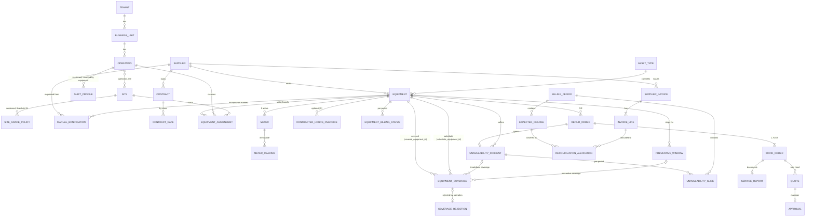

# Análisis inicial: control de proveedores de alquiler de equipos

**Estado:** borrador v3 para validación
**Fecha:** 2026-10-12
**Alcance:** Sector Flota y Equipos de la empresa
**Naturaleza:** proyecto de portafolio personal; si una empresa se interesa, se migra a proveedores de pago.

**Convención de etiquetas:** **[H]** hecho respaldado por documento o confirmación del usuario (los documentos se citan como «documento N», ver sección 3); las decisiones confirmadas por el usuario el 2026-10-12 se marcan **[H, confirmado por el usuario]**; **[S]** supuesto a validar; **[D]** decisión de diseño.

---

## 1. Resumen ejecutivo

El sector Flota y Equipos controla a proveedores que alquilan equipos: autoelevadores, zorras eléctricas, order pickers, containers y trastainers, y a futuro semirremolques. Los equipos se alquilan por mes y el cargo mensual es **fijo por equipo** [H]. El monto esperado sale de la tabla de contratos por clase de equipo, no de la línea del comprobante (sección 7.2). El alquiler facturado llega ya neto de los descuentos por indisponibilidad [H, confirmado por el usuario], y los sobrecostos se facturan aparte [H, confirmado por el usuario]. Las horas del horómetro alimentan dos controles: la **utilización** (horas reales frente a horas contratadas, que dependen del turno de la operación) y el **preventivo** (cada 250 o 500 horas según el tipo de equipo). Los **muletos** (equipos de reemplazo con estado Back up o Préstamo, nunca facturados) detienen la indisponibilidad mientras cubren un equipo roto o en mantenimiento preventivo. La indisponibilidad usa un **umbral W** por sitio (24 h en el sitio principal y 48 h en sitios satélite): si dentro de W no llegan ni la OT operativa ni un cierre manual justificado, ni un muleto confirmado que cubra el equipo, la indisponibilidad corre desde la fecha y hora de la OR (no desde el fin de la ventana), menos los tramos cubiertos; si la reparación (OT operativa o cierre manual justificado por el sector Flota y Equipos, auditado) o una cobertura llegan dentro de W, no hay indisponibilidad por ese incidente [H, confirmado por el usuario] (sección 7.5). La bonificación manual de 40% del tablero diario es excepcional: se pide a un proveedor cuando una operación tiene poca carga, es independiente de la indisponibilidad, queda siempre auditada y nunca se calcula sola [H, confirmado por el usuario] (sección 7.2).

Hoy el control se reparte entre un tablero diario en planilla, un reporte mensual de costos y los comprobantes de proveedor. La revisión documental encontró errores concretos: precios escritos dentro de fórmulas, filas sin factor de polinómica, horas negativas por reinicio de horómetro, horas contratadas distintas según el archivo y datos manuales faltantes. Con los cinco documentos adicionales se confirmó que ningún comprobante muestra descuentos por indisponibilidad como línea aparte (el usuario confirmó que llegan ya aplicados en el alquiler neto [H, confirmado por el usuario]) ni reparaciones con cargo en el comprobante mensual (se facturan aparte), y que el proveedor B facturó 47 equipos frente a 54 declarados, con discrepancias de estado en equipos concretos (por ejemplo EQ-0001 y EQ-0002).

**Propuesta:** una aplicación web modular (monolito modular con arquitectura hexagonal) que reemplace el tablero diario y el control mensual de costos en un núcleo de fases 0 a 4. El correctivo completo, la polinómica automática, los tableros gráficos y la IA quedan fuera de esa primera entrega. El stack propuesto es Next.js y TypeScript en Vercel Hobby, con Postgres en Neon Free, sin funciones propietarias en tiempo de ejecución (sección 10). El costo previsto es de 0 USD/mes; si una empresa se interesa, la migración a planes pagos es obligatoria por el uso comercial.

**Principio: EL SISTEMA ARRANCA VACÍO.** No hay datos de negocio precargados (ni proveedores, ni equipos, ni contratos, ni tarifas) en la aplicación ni en las migraciones; solo catálogos técnicos mínimos (sección 12.2, fase 0). El usuario crea los datos desde la interfaz para probar los flujos. Los datos de prueba son fixtures sintéticos en una carpeta de tests, cargados solo para tests específicos en un Postgres efímero (Docker); nunca en la base de la aplicación por defecto (sección 10.5).

**Pendiente antes de implementar:** validar este documento. No quedan preguntas bloqueantes: las ocho preguntas de la sección 16 quedan resueltas por confirmación del usuario. Restan dos supuestos por defecto [S] (S1 y S2) y varios puntos no bloqueantes, validables sin frenar el trabajo. Los descuentos por indisponibilidad ya no requieren una nota de crédito de muestra [H, confirmado por el usuario].

---

## 2. Qué se verificó y qué no

- **Nada de esto se ejecutó ni se probó.** No hay código, migraciones, tests ni prototipo en esta etapa.
- **Herramientas de diseño:** se evaluaron solo por documentación pública. No se instalaron ni probaron. El servidor MCP de OpenPencil no conectó durante la sesión (ECONNREFUSED), así que no se usó.
- **Documentos:** los hallazgos de la sección 3 provienen de la revisión de catorce archivos: los nueve de la versión anterior y cinco adicionales (comprobantes de Proveedores A, B y C, y declaraciones de horas de A y B). Las cifras son las de los documentos. La única verificación aritmética hecha para este documento es la suma del neto del proveedor B (sección 3.2), que coincide con el neto informado.
- **Limitación de los PDF:** los PDF se leyeron solo a través de su capa de texto. No se vieron sellos, firmas ni logos; no se puede afirmar que existan o no existan.
- **Proveedores C y D (sección 3.3):** se revisaron cinco comprobantes y sus soportes de C y un comprobante con su soporte de D. Los PDF se leyeron por su capa de texto; el soporte de D es una captura de imagen de baja resolución. Las asociaciones columna-valor de los soportes de C se infirieron del diseño de la planilla y se verificaron con aritmética donde se indica. No se vieron sellos ni anotaciones manuscritas.
- **Costos de infraestructura:** se tomaron de las páginas oficiales consultadas el 2026-10-12. Los precios y límites de los planes pueden cambiar. Varias cifras no están verificadas (lista en sección 10.7).
- **Reglas de negocio:** las marcadas [S] no están confirmadas por ningún documento ni por el usuario; son supuestos por defecto a validar (sección 16). Las reglas de muletos y de umbral (sección 6) provienen de la confirmación del usuario del 2026-10-12; no están respaldadas por documentos.

---

## 3. Hallazgos de los documentos reales

Los nombres de negocios, operaciones, sitios y proveedores se reemplazan por identificadores genéricos (Negocio 1, Operación 1, Sitio 1, Proveedor A a F). Los sitios se nombran como «sitio principal» y «sitios satélite». Los internos y las series de equipo también son identificadores sintéticos (formato `EQ-0001`, o alfanuméricos como `C-043` o `ZX-037`); cada caso usa el mismo identificador en todo el documento.

| # | Documento | Hallazgo clave |
|---|---|---|
| 1 | Comprobante de proveedor, tipo A | Corresponde a **horas extra de mecánica**, no a alquiler. Horas al 50%: 6 × 37.150,02; al 100%: 5 × 49.533,36. Subtotal 470.566,92; IVA 21% 98.819,05; percepción IIBB 1,6% 7.529,07; total 576.915,04. La hora al 100% equivale a 4/3 de la hora al 50%. Incluye CAE, pago a 30 días con cheque diferido e interés por mora de 4% mensual. No tiene referencia a OT, interno ni horómetro. Como sobrecosto, se factura aparte del alquiler mensual y se concilia en su propia columna [H, confirmado por el usuario]. Los comprobantes mensuales de alquiler están en el documento 10. |
| 2 | Orden de Reparación (formulario FR-MEQ-02) | Numerada por el **cliente**. Campos: operación, fecha y hora, número de servicio técnico, tipo de máquina, interno, checklist de 26 ítems, observaciones y tres firmas (solicitante, mecánico, receptor). No tiene horas, costo ni OT. |
| 3 | Orden de Trabajo del proveedor | Dice expresamente «no válido como comprobante». Incluye «Hs Est» (horas estimadas, no una lectura del horómetro), interno, marca, modelo, serie, código de cliente y observaciones del taller. El ejemplo no tiene cargo. |
| 4 | Planilla de servicio (escaneo manuscrito) | Casilla «con cargo / sin cargo», horas reales, referencia al número de OT, descripción del trabajo, repuestos, tiempo de mano de obra, total con IVA y conformidad del cliente. Es el **único vínculo OT–cargo**. No muestra tarifa horaria. |
| 5 | Presupuesto del proveedor | Mano de obra 120.000 + IVA 21% = 145.200. Validez 7 días. Garantía de 6 meses en repuestos y taller, sin garantía en electrónica reparada. Pago a 30 días. Firma «acepta presupuesto». Menciona cotización en USD aunque los montos están en ARS. La operación figura como texto libre y no tiene vínculo a OT. |
| 6 | Planilla de polinómica | Incremento = 0,65 × (USD₂/USD₁) + 0,10 × (IPC CABA₂/IPC CABA₁) + 0,10 × (IPIM₂/IPIM₁) + 0,15 × (CVS₂/CVS₁) − 1. Nuevo precio = precio anterior × (1 + incremento). Ejemplos: 21,39%, 7,80% y 10,62%. Bonificación de −1,5% aplicada de forma multiplicativa (1,2139 × 0,985 − 1 = 19,57%). Problemas: #REF!, fecha inválida, mes vacío y reinicio manual de la base. |
| 7 | Tablero diario de control (FR-MEQ-06) | 244 equipos: Proveedor A 121, B 91, C 16, D 8, E 6, F 2. Internos de texto (9001, C-043, ZX-037). Preventivo de 250 h (500 h para containers y trastainers). Estados: Vigente, Próximo a vencer (más de 75% del intervalo) y Vencido. El «último mantenimiento» es manual y falta en 78 de 244 equipos. Agosto: 143 vigentes, 87 vencidos, 14 próximos. Precios fijos dentro de fórmulas; 101 filas sin factor; horas negativas por reinicio de horómetro (por ejemplo −1763); horas contratadas fijas en 250 y horas disponibles fijas en 720. Recupero por indisponibilidad = (horas indisponibles / 24) × tarifa mensual / días del mes: fórmula fraccionaria que este documento **no admite** (sección 7.5). Recupero por alquiler parcial o NC: tarifa × 40% en algunos casos (bonificación manual y excepcional, sección 7.2). La grilla de indisponibilidad está vacía para agosto. |
| 8 | Reporte de costos por operación | 14 hojas mensuales (jul-2025 a ago-2026) con valores pegados, sin fórmulas. Pivote por operación: CHE, MHE, sobrecostos y recuperos. La mano de obra de baterías se imputa a las operaciones en proporción a los equipos con 2 baterías. Agosto 2026 (millones ARS): CHE 210,67; MHE 465,81; sobrecostos 30,86; recupero 1,62; total 705,73. **Inconsistencia:** 170 horas contratadas aquí frente a 250 en el tablero. |
| 9 | Informe mensual a dirección (PPTX, 19 diapositivas) | Indicadores de utilización y de indisponibilidad por operación, tipo de equipo y negocio; costos extra. Glosario: horas contratadas por turno (1 turno = 170, 2 turnos = 250, 3 turnos = 350); indisponibilidad = horas sin máquina por fallas del proveedor, con 24 h de gracia desde el aviso hasta la reparación (la gracia real depende del sitio; sección 6); costos extra = seguros, reparaciones, repuestos y muletos; recupero = nota de crédito por penalidades o negociación; calidad de servicio = cumplimiento de visita o llamado, que no se calcula en el tablero. Los gráficos son imágenes pegadas. |
| 10 A | Comprobante mensual de Proveedor A (ARS, IVA 21%, percepción IIBB 1,6%) | Una sola línea global «alquileres planta» por 5.780.206,51; sin detalle por equipo. Vencimiento 03/10, que contradice el pago a 30 días. Interés por mora de 4% mensual. No muestra descuentos como línea aparte (llegan aplicados en el neto [H, confirmado por el usuario]), ni reparaciones con cargo, baterías ni horas extra (se facturan aparte). |
| 10 B | Comprobante mensual de Proveedor B | 47 líneas, una por equipo, con precio fijo por clase: AE25 3.209.085,59 (×12); AE40 3.427.886,88 (×12); AP 3.719.621,93 (×13); TT 1.411.414,19 (×8); TIJ 1.677.476,56 (×1); ZHA 2.111.306,27 (×1). Neto 143.078.851,08. IVA con diferencia de 0,04 frente al 21% exacto (redondeo por línea). Cuatro páginas con totales repetidos. Número de orden de compra presente. Interés por mora de 5% mensual. |
| 10 C | Comprobante mensual de un emisor distinto de C y D (rotulado por error como «Proveedor C»; error de archivo confirmado por el usuario) | Un bloque: 2 internos a 3.173.321,15 cada uno. Período explícito 01 al 30/09. La percepción aparece impresa dos veces y se suma una sola vez. No muestra interés por mora. |
| 11 A | Declaración de horas de Proveedor A (xlsx) | Matriz mensual de 120 equipos en dos hojas, con pares HORAS/DIF por mes. Texto en celdas numéricas («En reparacion», «PARADA», «ALTA dd/mm») y un #VALUE!. Una lectura negativa (2220 pasa a 2200). Medidores sin variación. Período de marzo 2026, fuera de sincronía con el comprobante de septiembre 2026. Sin remitente, número de ticket ni firma. |
| 11 B | Declaración de horas de Proveedor B (PDF) | Ticket numerado, 54 equipos y dos lecturas (27/08 y 29/09; 33 días, no mes calendario). Columna de categoría: Alquiler 47, Back up 5, Préstamo 2. Una lectura negativa (−6) y dos ceros. |

### 3.1 Prototipo académico previo (solo reutilización conceptual)

**Conceptos reutilizados:** tarifas mensuales versionadas por equipo; ajustes por porcentaje de proveedor; registro de horas y de mantenimientos; costos extra; indisponibilidades con descuento (con la regla de días enteros de la sección 7.5 en lugar del prorrateo fraccionario); historial de movimientos; cadena OR → OT → presupuesto → comprobante; baja lógica con motivo; exportación CSV. Fórmula de cargo de referencia: alquiler + extras + reparaciones − recuperos − indisponibilidades, elegible solo si el alquiler cubre el período. [H]

**Debilidades descartadas (no se trasladan):** escrituras sin autenticación en varios controladores; sin protección CSRF; sin control de roles; archivos subidos dentro de la raíz web con su nombre original; errores que exponen detalles internos; credenciales de base de datos fijas en el código; esquema sin versionar; operaciones sin transacciones; numeración de OR con `MAX(id)+1` (condición de carrera); dos fuentes de verdad para el horómetro; tests tautológicos; sin aislamiento por tenant.

### 3.2 Comparación de comprobantes y declaraciones nuevos

| Aspecto | Proveedor A | Proveedor B | Otro emisor (documento 10 C) |
|---|---|---|---|
| Granularidad del comprobante | Global (una línea de planta) | Por equipo (47 líneas) | Por bloque (2 internos) |
| Monto de referencia | 5.780.206,51 | 143.078.851,08 (neto) | 3.173.321,15 por interno |
| Precio por equipo visible | No | Sí, fijo por clase | Sí, por interno |
| Vencimiento e interés | Vence 03/10 (contradice 30 días); 4% mensual | Interés 5% mensual; vencimiento no extraído | Sin interés mostrado |
| Declaración de horas | Sí (documento 11 A), período marzo 2026 | Sí (documento 11 B), 54 equipos | No hay |
| Equipos declarados frente a facturados | No comparable (sin detalle por equipo) | 54 declarados, 47 facturados | No comparable |
| Categoría del equipo | No consta en la declaración | 47 Alquiler, 5 Back up, 2 Préstamo | No hay declaración |

**Común a los tres comprobantes [H]:** mensuales, en ARS, IVA 21%, percepción IIBB 1,6%, pago a 30 días y comprobante de crédito electrónico (FCE) con aceptación tácita. Ninguno muestra descuentos por indisponibilidad como línea aparte ni baterías. Según confirmación del usuario [H, confirmado por el usuario], los descuentos por indisponibilidad llegan ya aplicados en el alquiler mensual (neto), y las reparaciones con cargo y las horas extra se facturan aparte, con su propia cadena documental (sección 7.2).

**Cruce del proveedor B [H]:**
- Suma de control del neto: 12 × 3.209.085,59 + 12 × 3.427.886,88 + 13 × 3.719.621,93 + 8 × 1.411.414,19 + 1.677.476,56 + 2.111.306,27 = 143.078.851,08, igual al neto facturado.
- EQ-0001 figura como Alquiler en la declaración y no está facturado.
- EQ-0002 figura como Back up en la declaración y sí está facturado.
- Consecuencia de la regla confirmada de que Back up y Préstamo no se facturan [H, confirmado por el usuario]: según este cruce, de las 47 líneas facturadas una corresponde a EQ-0002 (Back up), es decir, 46 son alquiler, y EQ-0001 (alquiler) no está facturado. La comparación debe hacerse por conjunto (Alquiler frente a facturado), no solo por conteo (47 frente a 54).
- Hay una diferencia de serie entre documentos (interno frente a serie) y un sufijo «Li» en algunos códigos que impide la comparación directa.
- Utilización observada: promedios de 60 a 84 h/mes, aproximadamente 25 a 35% de las 250 h contratadas. Es un dato observado sobre una ventana no calendario, no un indicador oficial.

**Implicaciones:** el monto esperado sale de la tabla de contratos por clase, nunca de la línea del comprobante; el estado facturable (alquiler, back up, préstamo) es un dato propio por período; el comprobante se modela con tres granularidades (sección 7.2); los internos del proveedor se mapean a los de la empresa mediante una tabla de alias.

### 3.3 Proveedores C y D (operaciones de otra región)

Documentos adicionales de la empresa: cinco comprobantes de C con sus soportes y un comprobante de D con su soporte. Corresponden a operaciones de otra región. Todos los importes están en ARS y los internos se citan solo como identificadores genéricos.

| Aspecto | Proveedor C | Proveedor D |
|---|---|---|
| Estructura del comprobante [H] | Cinco comprobantes, separados por concepto: abono fijo, horas adicionales y operarios, cada uno con su propio código de servicio. Una línea de importe por equipo, sin cantidad ni precio unitario | Una sola línea global de alquiler por 30.874.728,79; el detalle por equipo está solo en el soporte |
| Impuestos [H] | IVA 21% y percepción IIBB 1,6% | IVA 21%; sin percepción IIBB |
| Pago y mora [H] | 30 días; interés por mora diario sobre una tasa bancaria, pasados 30 días | 40 días informados en el soporte (41 en el comprobante); interés por mora de 1% diario hasta la cancelación |
| Aritmética [H] | Los cinco comprobantes cuadran al centavo (subtotal, IVA y percepción exactos) | Subtotal + IVA = total; la suma de las 16 filas del soporte, menos la bonificación, coincide con el subtotal |
| Soporte [H] | Planilla de resumen de servicios: rangos de horas contratadas por clase, valor de la hora adicional, horas por horómetro y detalle diario por máquina | Captura de una planilla de cálculo: valor mensual por clase de equipo y 300 horas libres mensuales por equipo; sin lecturas de horómetro |
| Reglas observadas [H] | Cuota fija por clase con rango contratado (400, 300 y 600 h según la clase) y tarifa de hora adicional por clase; horas de operario al 50%, al 100% y nocturnas | Prorrateo por días en el ingreso y egreso de reparación; sin descuento cuando la indisponibilidad figura como «no atribuible»; bonificación permanente de 18% sobre un tipo de equipo |

**Hallazgos sobre C [H]:**
- Los precios unitarios y las horas no figuran en el comprobante; solo están en el soporte. El comprobante muestra el importe final.
- Un mismo soporte respalda dos comprobantes en dos casos (abono más operarios, y abono más horas adicionales): la relación soporte–comprobante es N:M.
- Un soporte contiene importes (horas adicionales y operarios) que no figuran en ningún comprobante entregado: quedan «soportados y no facturados» hasta que se reciban los comprobantes faltantes.
- La numeración tiene huecos: faltan números de comprobante entre los entregados [S: no entregados, no necesariamente no emitidos].
- Hay una inconsistencia de período entre el título del soporte y el período de la línea, y una fecha de emisión anterior al inicio del período facturado.
- Las horas diarias de la planilla no coinciden con las horas por horómetro del mismo mes. La cuota fija se cobra igual porque ambas quedan bajo el rango contratado, de modo que la diferencia no cambia el importe pero sí el control.
- Las diferencias de centavos entre soporte y comprobante provienen de redondear la tarifa horaria antes o después de multiplicar.
- El documento 10 C (sección 3.2) pertenece a un emisor distinto de C y D: se rotuló por error [H, confirmado por el usuario]. No debe usarse como fixture de C; el valor de 3.173.321,15 por interno no es una tarifa de C.

**Hallazgos sobre D [H]:**
- El prorrateo por días se verificó con aritmética para dos equipos (22/30 y 20/30 de la cuota).
- La indisponibilidad marcada «no atribuible» no genera descuento; el equipo se cobra completo.
- La bonificación de 18% es permanente y no depende del período.

**Limitaciones [H]:** solo se leyó la capa de texto de los PDF; no se vieron sellos ni anotaciones manuscritas. No se observaron muletos (Back up o Préstamo) ni descuentos por indisponibilidad como línea aparte en C ni en D.

---

## 4. Actores y alcance de v1

**Actores [S]:** `admin`, `fleet_analyst` (carga y conciliación), `manager` (aprueba presupuestos y reaperturas), `supervisor` (OR y lecturas de su alcance) y `viewer`. Alcance: tenant, unidad de negocio, operación o sitio, asignado por usuario. **Coberturas con muletos [S]:** el `supervisor` del sitio registra la llegada y el retiro; el `fleet_analyst` confirma con evidencia. El sector Flota y Equipos define el estado facturable del muleto al registrarlo [H, confirmado por el usuario] (sección 7.2).

**Fuera de v1: portal de proveedores.** Los documentos de proveedor (comprobantes, OT, presupuestos, declaraciones) los registra la empresa a partir de papel o archivos recibidos. Las declaraciones y comprobantes se importan desde archivo con revisión humana antes de confirmar (sección 7.2). Un portal agregaría identidades externas, alcance por proveedor y superficie de seguridad, sin reducir ningún paso verificado hoy. Se reevalúa en una fase posterior si un proveedor lo exige. [D]

**Usuarios de la v1 y visibilidad de costos [D, confirmado por el usuario]:** la v1 es solo para el sector Flota y Equipos, y todos sus usuarios ven los costos. No se define todavía un permiso de costos separado. La expansión al resto de la empresa queda fuera de la v1 y se registra en el issue #17: jefes y gerentes de operación y gerentes de división verían los costos de su alcance, y un administrativo de la operación cargaría solicitudes de reparación y vería los vencimientos de preventivos sin ver costos.

---

## 5. Procesos a digitalizar

1. Registro de horómetros y cálculo de horas del período (reemplaza lecturas en planilla).
2. Control preventivo por tipo de equipo (250 o 500 h) y estados de vencimiento.
3. Cálculo mensual de costos por equipo y operación: cargo fijo por clase según contrato, horas contratadas, sobrecostos, indisponibilidades (netas de la cobertura por muletos) y bonificaciones manuales (recuperos).
4. Cierre y reapertura de período con auditoría.
5. Importación de comprobantes y declaraciones de proveedor, y conciliación contra los cargos esperados, con discrepancias detectadas.
6. Ciclo correctivo: OR, OT, planilla de servicio, presupuesto y aprobación (la OR y la OT mínimas se adelantan a la fase 3).
7. Seguimiento de OT pendientes: incidentes abiertos sin OT del proveedor, con alertas por antigüedad y cierre manual auditado.
8. Ajuste de tarifas por polinómica (fase posterior).
9. Informe mensual a dirección.

---

## 6. Reglas de negocio

| Regla | Estado | Fuente |
|---|---|---|
| Equipos alquilados por mes; cargo mensual fijo por equipo | Confirmada por el usuario | Enunciado |
| Regla única de indisponibilidad para todos los proveedores | Confirmada por el usuario | Enunciado |
| Umbral W por sitio: 24 h en el sitio principal y 48 h en sitios satélite; configurable por sitio | Confirmada por el usuario [H, confirmado por el usuario] | Enunciado |
| El reloj inicia con la fecha y hora de la OR; se detiene al iniciar una cobertura confirmada y termina al recibir la OT del proveedor con el equipo operativo o con un cierre manual justificado por el sector Flota y Equipos, auditado | Confirmada por el usuario [H, confirmado por el usuario] | Enunciado |
| Umbral: si ni la OT operativa ni un cierre manual justificado llegan en [OR, OR + W], ni una cobertura confirmada comienza en ese intervalo, la indisponibilidad cuenta desde la fecha y hora de la OR (no desde el fin de la ventana), menos las coberturas. Si la reparación (OT operativa o cierre manual justificado) o una cobertura llegan dentro de W, no hay indisponibilidad por ese incidente (las horas previas no cuentan) | Confirmada por el usuario [H, confirmado por el usuario] | Enunciado; sección 7.5 |
| Valor automático = tarifa mensual / días del mes × días enteros indisponibles; existe también un modo manual para excepciones que no coinciden con el cálculo lógico | Confirmada por el usuario | Enunciado |
| El valor de indisponibilidad se **resta** del alquiler; el alquiler facturado llega ya neto de ese descuento (sin línea ni nota de crédito aparte) | Confirmada por el usuario [H] | Enunciado |
| Sobrecostos (reparaciones con cargo, horas extra) se facturan aparte del alquiler mensual; concilian contra su propia cadena OR/OT/presupuesto, en columna propia | Confirmada por el usuario [H] | Enunciado |
| Se cuentan días enteros; la fórmula fraccionaria (horas / 24) del documento 7 no se admite | Confirmada por el usuario; reemplaza el documento 7 | Enunciado; documento 7 |
| Redondeo de días enteros: `floor` (bloques completos de 24 h); los demás modos son valores de política configurables | Confirmada por el usuario [H] (default `floor`) | Enunciado |
| El umbral no se resta de las horas: W decide si la cobertura llega a tiempo, y las horas son horas corridas | Confirmada por el usuario [H, confirmado por el usuario] | Confirmación del usuario; sección 7.5 |
| Horas no cubiertas: se suman todas antes de aplicar `floor`, una sola vez | Confirmada por el usuario [H, confirmado por el usuario] | Confirmación del usuario; sección 7.5 |
| Las OT no siempre llegan: la OR abierta sin OT debe detectarse | Requisito confirmado; mecanismo [D] | Enunciado; sección 7.5 |
| Bonificación manual del 40% (recupero del tablero): excepción manual y no automática, pedida a un proveedor cuando una operación tiene poca carga; porcentaje y/o monto, motivo, operación solicitante, aprobador y período; siempre auditada; independiente de la indisponibilidad | Confirmada por el usuario [H, confirmado por el usuario] | Confirmación del usuario; documento 7; sección 7.2 |
| Utilización = horas reales / horas contratadas vigentes | [D] criterio de aceptación de fase 1 | Sección 12 |
| Horas contratadas según los turnos de la operación: 1 turno = 170, 2 turnos = 250, 3 turnos = 350. La mayoría de las operaciones trabaja 2 turnos de 06:00 a 22:00 (250 h); una operación trabaja 3 turnos (350 h); una operación trabaja 24 h (su mapeo es punto abierto no bloqueante). Atributo de la operación; el override por equipo es opcional [S]; solo afecta el indicador de utilización, no la facturación | Confirmada por el usuario [H, confirmado por el usuario] | Glosario, documento 9; confirmación del usuario; supuesto S2 |
| Horas contratadas hoy: 250 fijas (tablero) y 170 (reporte de costos) | Inconsistencia observada | Documentos 7 y 8 |
| Preventivo de 250 h (500 h para containers y trastainers); «Próximo a vencer» = más de 75% del intervalo | Confirmada en documento | Documento 7 |
| Equipo sin último mantenimiento queda en «sin dato» | [D] propuesta | Sección 12 |
| Presupuesto válido 7 días; solo un presupuesto aprobado habilita un cargo de reparación | Validez confirmada en documento; aprobación gerencial documentada | Documento 5 |
| OR numerada por el cliente; OT del proveedor sin costo; planilla de servicio como único vínculo OT–cargo | Confirmada en documentos | Documentos 2 a 4 |
| Garantía de 6 meses en repuestos y taller; sin garantía en electrónica reparada | Confirmada en documento | Documento 5 |
| Pago a 30 días; interés por mora de 4% mensual (documentos 1 y 5) y de 5% mensual en el comprobante de B | Confirmada en documentos | Documentos 1, 5 y 10 B |
| Polinómica: fórmula y bonificación multiplicativa de −1,5% | Fórmula confirmada en documento | Documento 6 |
| Aplicación de la polinómica: sobre la tarifa vigente (encadenada): nueva tarifa = tarifa vigente × (1 + incremento) | Confirmada por el usuario [H, confirmado por el usuario] | Confirmación del usuario; documento 6 |
| Horas extra al 50% y 100%: se registran como sobrecosto con monto informado, no calculado | [D] propuesta | Documento 1 |
| Back up y Préstamo no se facturan (equipos no facturables) | Confirmada por el usuario [H] | Enunciado |
| Muleto (Back up o Préstamo) que reemplaza un equipo roto o en mantenimiento preventivo: mientras cubre, la indisponibilidad no corre | Confirmada por el usuario [H] | Confirmación del usuario, 2026-10-12 |
| Sin OT operativa, cierre manual justificado ni cobertura confirmada dentro de W, la indisponibilidad corre desde la OR (no desde el fin de la ventana); una OT o un cierre manual justificado que llega dentro de W sin cobertura da 0 días | Confirmada por el usuario [H, confirmado por el usuario] | Confirmación del usuario |
| Muleto que llega después de W: el tiempo desde la OR hasta su llegada cuenta como indisponible (llegada a la hora 30 → 30 h → 1 día) | Confirmada por el usuario [H, confirmado por el usuario] | Confirmación del usuario; sección 7.5 |
| El muleto no se factura y no genera cargo de alquiler | Confirmada por el usuario [H] | Confirmación del usuario, 2026-10-12 |
| Muleto como activo propio (medidor, preventivo, OR y OT); si se rompe, su incidente se registra con valor 0 | [D]; valor 0 [S] | Sección 7.2 |
| Retiro o rotura del muleto antes de la reparación: la indisponibilidad se reanuda en ese momento; no se abre una nueva ventana W; el tiempo no cubierto posterior cuenta completo. Si es un retiro con reparación pendiente, se emite una alerta de revisión (excepción poco frecuente) | [S] (S1) | Sección 7.5 |
| Coberturas solapadas: unión de intervalos; un muleto no cubre dos equipos a la vez | [D] | Sección 7.2 |
| Preventivo sin muleto: nunca genera indisponibilidad (la detención planificada no es una falla) | Confirmada por el usuario [H, confirmado por el usuario] | Confirmación del usuario, 2026-10-12 |
| Muleto de otra clase: cuenta como cobertura salvo que la operación rechace el reemplazo por no serle útil; el rechazo se registra con motivo, actor, fecha y hora, y queda auditado; un reemplazo rechazado no cubre; `class_match` queda como atributo informativo | Confirmada por el usuario [H, confirmado por el usuario] | Confirmación del usuario; sección 7.2 |
| Estado facturable (Alquiler, Back up, Préstamo) por equipo y período: lo define el sector Flota y Equipos al registrar un muleto o cobertura, y se guarda con su fuente | Confirmada por el usuario [H, confirmado por el usuario] | Confirmación del usuario; sección 7.2 |
| Registro de cobertura: el `supervisor` registra llegada y retiro; el `fleet_analyst` confirma con evidencia; sin confirmación la cobertura queda `pending_evidence` y no cuenta al cerrar el período | [S] | Sección 7.2 |
| Interno: texto; el interno del proveedor puede diferir del de la empresa | Confirmada en documentos | Documentos 7 y 11 |
| Unicidad del interno: es único dentro de un proveedor (un proveedor no lo repite en dos equipos) y puede coincidir con el de otro proveedor; la identidad del equipo es (proveedor, interno). Resuelve la antigua pregunta abierta sobre unicidad | Confirmada por el usuario [H, confirmado por el usuario] | Confirmación del usuario; sección 7.2 |
| Horas contratadas insuficientes: en algunas operaciones las horas contratadas no cubren el uso y el proveedor factura las horas adicionales en un comprobante aparte, con su propia tarifa | [S] lectura del usuario, a confirmar por proveedor | Confirmación del usuario; sección 3.3 (C) |
| Prorrateo por días en el ingreso y egreso de reparación, e indisponibilidad «no atribuible» sin descuento | [H] observado en D; el alcance de la regla por proveedor queda abierto (sección 16) | Sección 3.3 (D) |
| Bonificación permanente por equipo o tipo de equipo (por ejemplo 18%), distinta de la bonificación manual excepcional | [H] observado en D | Sección 3.3 (D) |
| Muleto: no existe una regla escrita que lo defina, así que la define el proyecto: no se factura; detiene la indisponibilidad desde que cubre; la operación puede rechazarlo (cobertura rechazada); las excepciones se revisan manualmente con auditoría | [D] | Secciones 7.2 y 7.5 |
| Reemplazo de horómetro: quién lo informa y con qué evidencia | No bloqueante (sección 16) | Sección 16 |
| Significado de CHE y MHE | No bloqueante (sección 16) | Sección 16 |

---

## 7. Modelo de dominio

### 7.1 Módulos (bounded contexts)

| Módulo | Responsabilidad | No hace |
|---|---|---|
| `organization` | Tenant, negocio, operación (con su perfil de turnos), sitio, relación operación–sitio N:M, usuarios y alcances | Costos |
| `fleet` | Proveedor, tipo de activo, equipo, alias de internos del proveedor, historial de asignaciones (operación, sitio, proveedor) con vigencia | Lecturas, tarifas |
| `metering` | Medidores, lecturas inmutables, correcciones, reemplazos, horas del período | Preventivo |
| `maintenance` | Plan preventivo por tipo (250 o 500 h), ventanas preventivas, OR, OT, presupuestos, aprobaciones, incidentes de indisponibilidad, coberturas con muletos y rechazos de reemplazo [D] | Comprobantes |
| `pricing` | Contratos y tarifas por clase de equipo, versionados; overrides por equipo; ajustes (polinómica) como nuevas versiones; conceptos de cargo | Conciliación |
| `billing` | Período, cargo esperado, políticas de umbral y redondeo, descuentos por indisponibilidad (slices), comprobantes y líneas, adaptadores de importación, conciliación, discrepancias, bonificaciones manuales, cierre | Mantenimiento |
| `reporting` | Proyecciones de lectura (tableros, informe mensual) | Escrituras de negocio |
| `shared` | Result, Money, Period, auditoría, eventos, contexto de tenant | — |

**[D]** `billing` consume datos de `metering`, `maintenance` y `pricing` solo mediante puertos de consulta; no importa su infraestructura. `reporting` lee vistas SQL y nunca escribe.

### 7.2 Decisiones de modelado

- **Tipo de activo genérico [D]:** `asset_type` (autoelevador, zorra, order picker, containera, trastainer; futuro semirremolque) con `meter_kind` (`hours` | `km` | `none`) y `preventive_interval` (250 o 500 h, documento 7). Los semirremolques entran sin migración de esquema.
- **Interno [H]:** texto, no numérico (documento 7: `9001`, `C-043`, `ZX-037`). Unicidad `(tenant, supplier, internal_code)` [H, confirmado por el usuario]: el interno es único dentro de un proveedor y puede repetirse entre proveedores (sección 6).
- **Alias de identificadores del proveedor [H/D]:** los internos del proveedor difieren de los de la empresa (documento 11). `supplier_equipment_alias(supplier, supplier_internal_code, serial, equipment_id, valid_from, valid_to)`. Se normalizan mayúsculas y espacios; los sufijos (por ejemplo «Li») **no** se eliminan automáticamente: generan discrepancia.
- **Asignación con vigencia [D]:** `equipment_assignment(equipment, operation, site, valid_from, valid_to)`. Invariante: sin solapamientos por equipo (restricción de exclusión en Postgres). El costo de un período se imputa a la asignación vigente; si hay cambio a mitad de mes, se prorratea por días **[S]**.
- **Operación–sitio N:M [H]** (enunciado): tabla `operation_site`; la asignación valida que el par exista.
- **Turnos de la operación [H, confirmado por el usuario]:** el turno es un atributo de la **operación**, con vigencia (`operation_shift_profile(operation, shifts ∈ 1 | 2 | 3 | 24h, valid_from, valid_to)`), y sus equipos lo heredan. Las horas contratadas son función de ese perfil (170, 250 o 350; sección 6). Un override de horas contratadas por equipo es opcional [S] (supuesto S2) y solo afecta el indicador de utilización.
- **Estado facturable por período [H/D]:** `equipment_billing_status(equipment, status ∈ rental | backup | loan, valid_from, valid_to, source)`. B declara 47 equipos en Alquiler, 5 en Back up y 2 en Préstamo (documento 11). Back up y Préstamo no se facturan [H, confirmado por el usuario]: solo el estado Alquiler genera cargo de alquiler. El sector Flota y Equipos define el estado facturable de cada equipo por período al registrar un muleto o una cobertura [H, confirmado por el usuario]; el campo `source` guarda esa fuente.
- **Contrato y tarifa por clase [D]:** `contract(supplier, ref, valid_from)` y `contract_rate(contract, equipment_class, amount, valid_from, valid_to)`, con override opcional por equipo. Es la fuente principal del monto esperado y reemplaza a una tarifa por equipo como fuente principal. La línea del comprobante nunca es la fuente del esperado. La polinómica genera nuevas versiones de `contract_rate` sobre la tarifa vigente (encadenada: nueva = vigente × (1 + incremento)). Sin tarifa vigente para la clase, el cálculo devuelve un error tipado.
- **Lecturas de medidor [D]:** eventos inmutables `meter_reading(meter, read_at, value, kind)` con `kind` ∈ `reading | correction | replacement_close | replacement_open`. Una corrección referencia la lectura corregida (`corrects_id`) y nunca la edita. Un reemplazo cierra el medidor anterior y abre uno nuevo con valor inicial. Las horas del período son la suma de deltas por segmento de medidor. Un delta negativo sin reemplazo es una anomalía que bloquea el cierre (documento 7 muestra −1763).
- **Horas contratadas [H, confirmado por el usuario]:** 170, 250 o 350 según el turno de la operación (documento 9); frente a 250 fijo (documento 7) y 170 (documento 8). La fuente es el perfil de turnos de la operación (bullet anterior); el override por equipo es opcional [S].
- **Período [D]:** `billing_period(tenant, year_month, status, version)`. Cierre y reapertura auditados con motivo obligatorio. Reabrir incrementa `version` y conserva el snapshot anterior.
- **Cargo esperado, línea de comprobante y asignación [D]:** `expected_charge` (lo que calcula el sistema), `invoice_line` (lo que cobra el proveedor, con `granularity` ∈ `global` | `per_equipment` | `block`) y `reconciliation_allocation(line, charge, amount)` (el vínculo). Invariantes: unique `(line, charge)`; Σ de asignaciones por línea ≤ monto de la línea; Σ de asignaciones por cargo ≤ monto del cargo. Una línea puede cubrir varios cargos esperados y un cargo puede cubrirse con varias líneas. La clave natural de `expected_charge` es `(tenant, period, equipment, concept, source_ref)`.
- **Validación de cabecera de comprobantes [D]:** neto + IVA + percepción = total, con tolerancia de centavos por línea **[S]** (B difiere 0,04 en IVA). Los totales repetidos por página (B) y la percepción impresa dos veces (C) no se suman dos veces.
- **Importación por proveedor [D]:** `SupplierDocumentParser` por tipo (`hour_declaration`, `invoice`) → `Result<ParsedDocument, ParseIssue[]>`. Adaptadores iniciales: declaración de A (matriz xlsx), declaración de B (PDF), comprobantes de A, B y C. Flujo: archivo → `import_batch` y `import_row` (crudo, normalizado, issues) → revisión humana → confirmación transaccional. Los fixtures de tests son réplicas sintéticas.
- **Muleto como activo [D]:** un muleto es un `equipment` común, con `equipment_billing_status` en `backup` o `loan` durante el intervalo. Tiene medidor, lecturas, preventivo, OR y OT propios, y su historial aparece en «historial de un equipo». No genera cargo de alquiler [H, confirmado por el usuario]. Si se rompe, su incidente se registra con valor 0, porque no tiene tarifa [S].
- **Cobertura [D]:** entidad `equipment_coverage(id, tenant, covered_equipment_id, substitute_equipment_id, reason ∈ breakdown | preventive, incident_id?, preventive_window_id?, started_at, ended_at?, end_reason ∈ repaired | withdrawn | substitute_failed | replaced | voided, class_match ∈ same | equivalent | non_equivalent (solo informativo), status ∈ pending_evidence | confirmed | disputed, registered_by, registered_at, evidence[])`.
  - **Rechazo por la operación [H, confirmado por el usuario]:** entidad `coverage_rejection(coverage_id, reason, rejected_by, rejected_at)`, con motivo obligatorio. Un reemplazo rechazado por la operación (porque no le es útil) no cubre ningún intervalo y no cuenta para el umbral W. El rechazo queda auditado. Si el rechazo llega después de horas ya cubiertas, el cálculo se rehace como si la cobertura nunca hubiera existido [D].
  - `reason = breakdown` exige `incident_id`; `reason = preventive` exige `preventive_window_id`.
  - Invariantes: un muleto cubre un solo equipo a la vez (restricción de exclusión sobre `substitute_equipment_id` y el intervalo); `started_at < ended_at`; el intervalo efectivo se recorta al intervalo del incidente.
  - Un equipo puede tener varias coberturas sucesivas. Si se solapan, no se suman dos veces (se usa la unión).
  - Cierre automático: al recibir la OT operativa o registrar un cierre manual justificado (sección 7.5), la cobertura abierta se cierra con `end_reason = repaired` para el cálculo. La devolución física del muleto se registra aparte [D].
- **Ventana preventiva [D]:** entidad nueva `preventive_window(equipment, started_at, ended_at?, ot_ref?)`. Es la detención planificada que una cobertura de tipo `preventive` puede cubrir.
- **Registro de coberturas [S]:** el `supervisor` del sitio registra la llegada y el retiro, porque es quien los ve. El `fleet_analyst` confirma con evidencia (remito o ticket del proveedor, foto o referencia en la OT). Se guardan dos tiempos: `started_at` (declarado) y `registered_at` (sistema). El registro retroactivo se permite con auditoría: recalcula si el período está abierto y genera `unavailability_adjustment` si está cerrado (sección 7.5). Una cobertura sin evidencia queda en `pending_evidence`, que no se cuenta como confirmada al cerrar el período.
- **Discrepancias [D]:** entidad `discrepancy` con estados `open` → `accepted` | `disputed` → `resolved`, con motivo y auditoría. Tipos a detectar: `declared_rental_not_billed` (declarado Alquiler pero no facturado; EQ-0001); `billed_non_billable_status` (facturado siendo no facturable, Back up o Préstamo; EQ-0002); `billed_not_declared`; `count_mismatch` (comparación por conjunto Alquiler frente a facturado, no solo por conteo); `discount_mismatch` (el descuento del proveedor difiere del calculado por el sistema [H, confirmado por el usuario]); `serial_mismatch` (interno frente a serie); `negative_reading` (−6; 2220 → 2200); `frozen_reading` (delta 0 con estado `rental` en N períodos **[S]**); `non_numeric_cell` («En reparacion», «PARADA», «ALTA dd/mm», #VALUE!), que se proponen como pistas (incidente o fecha de alta) y nunca se aplican solas; `rate_mismatch`, `header_total_mismatch` y `due_date_inconsistent` (A: vencimiento 03/10 frente a 30 días); `period_mismatch` (A: declaración de marzo frente a comprobante de septiembre).
- **Discrepancias de cobertura [D]:** `backup_without_coverage` (equipo declarado Back up o Préstamo sin cobertura registrada en el período); `coverage_substitute_not_backup` (el muleto de una cobertura figura como Alquiler o está facturado; se suma a `billed_non_billable_status`, el caso EQ-0002 ya observado); `coverage_substitute_not_declared` (el muleto no aparece en la declaración de horas); `substitute_hours_outside_coverage` (el medidor del muleto avanza fuera de los intervalos de cobertura) [S]; `covered_equipment_hours_while_down` (el equipo cubierto suma horas mientras figura roto; evidencia inconsistente). Se mantiene `discount_mismatch`: el alquiler neto facturado no coincide con el esperado menos los días no cubiertos. Los tipos `declared_rental_not_billed` y `billed_non_billable_status` quedan para revisión humana; la facturabilidad por período la define el sector Flota y Equipos (bullet de estado facturable).
- **Períodos no calendario [D]:** las lecturas son eventos con fecha (B: 27/08 a 29/09, 33 días). No se interpola por defecto. Las horas se imputan al período de la lectura final **[S]**, y la utilización se informa con la ventana real y marca `window_not_calendar`. La conciliación del alquiler **no depende de horas**: depende de estado facturable y tarifa.
- **Descuentos dentro del alquiler facturado [H, confirmado por el usuario]:** el alquiler llega neto de los descuentos por indisponibilidad; no aparecen como líneas, notas de crédito ni comprobantes aparte (sección 3.2). El esperado neto es tarifa − descuento calculado (automático o manual). El sistema compara ese esperado neto con el monto facturado y marca las diferencias, incluida la diferencia entre el descuento del proveedor y el cálculo del sistema (`discount_mismatch`). Las reparaciones con cargo y los sobrecostos se concilian en su propia columna y cadena (ver conceptos de cargo abajo). La bonificación manual de 40% del tablero diario es un concepto aparte, descrito en el bullet siguiente; no se mezcla con el descuento por indisponibilidad.
- **Bonificación manual [H, confirmado por el usuario]:** `manual_bonification(id, tenant, supplier_id, equipment_id, requesting_operation_id, percentage?, amount?, reason, period, requested_by, approved_by, created_at)`, con al menos `percentage` o `amount`. Es una excepción: cuando una operación tiene poca carga de trabajo, pide a un proveedor un descuento sobre el equipo, y el proveedor suele bonificar 40% del valor del equipo. Nunca se calcula automáticamente y es independiente de la regla de indisponibilidad. Motivo, operación solicitante, aprobador y período son obligatorios, y cada bonificación queda auditada. Qué rol aprueba la bonificación es punto abierto no bloqueante (sección 16). Se concilia como concepto `manual_bonification` (ver conceptos de cargo abajo).
- **OR 1..N OT [H]:** la OR la numera el cliente (documento 2); la OT es del proveedor (documento 3) y no trae costo. La planilla de servicio (documento 4) es el único vínculo OT–cargo: `service_report(ot, with_charge, real_hours, total)`. La OR y la OT mínimas (número, fecha y hora, equipo, OT recibida) se adelantan a la fase 3; el correctivo completo sigue en la fase 5.
- **Presupuesto y aprobación [H]:** validez de 7 días (documento 5) y aprobación de gerente. Solo un presupuesto aprobado habilita un cargo esperado de reparación.
- **Indisponibilidad [D]:** entidades `site_grace_policy(site, grace_hours, valid_from, valid_to)`, versionada y sin solapamiento, donde `grace_hours` es el umbral W (24 h en el sitio principal, 48 h en satélites) [H, confirmado por el usuario]; `unavailability_policy(tenant, rounding_mode, valid_from)`, versionada (`rounding_mode` [D], default `floor`); `unavailability_incident(equipment, repair_order_id, site_id_snapshot, grace_hours_snapshot, policy_version, started_at, ot_ref, ot_received_at (o la fecha del cierre manual justificado, con `close_reason = manual`), status, close_reason)`, donde W (`grace_hours_snapshot`) y el sitio se **congelan al abrir** el incidente; y `unavailability_slice(incident, period, whole_days, monthly_fee, days_in_month, auto_amount, override_amount, override_reason, overridden_by, overridden_at, effective_amount, is_provisional)`, con `effective_amount = override_amount ?? auto_amount` y ambos valores conservados. No existe un modo de resta: el umbral es la única forma de tratar la ventana. Cálculo, redondeo y casos borde en la sección 7.5.
- **Conceptos de cargo esperado [D]:** `rental` (+), `unavailability_deduction` (−, ya aplicado en el alquiler neto facturado [H, confirmado por el usuario]) y `chargeable_repair` (+, en columna propia; los sobrecostos se facturan aparte del alquiler mensual [H, confirmado por el usuario] y concilian contra su propia cadena OR/OT/presupuesto); `manual_bonification` (−, excepcional y auditada, nunca automática; independiente de la indisponibilidad).
- **Cargo diferido [H]:** el comprobante del documento 1 se emitió el 24/09 por agosto. Un cargo esperado pertenece al período en que se originó y puede conciliarse con comprobantes de períodos posteriores; queda `pending_invoice` hasta su asignación.
- **Comprobante con líneas conceptuales [D]:** además de la línea por equipo, el comprobante admite líneas por concepto (abono, horas adicionales, operarios, reparaciones con cargo), cada una con su código de servicio, como en C (sección 3.3). Un comprobante puede mezclar ambas formas.
- **Documento de soporte [D]:** el soporte (resumen de servicios, planilla) es una entidad propia, con su fecha y su período, y puede respaldar varios comprobantes (N:M). Un importe del soporte se cuenta una sola vez aunque el soporte se reutilice.
- **Conciliación por concepto [D]:** se compara lo esperado (contrato + tarifas + lecturas) con lo facturado, concepto por concepto. Se marca como «soportado y no facturado» el importe del soporte sin comprobante, y se detectan huecos en la numeración de comprobantes por emisor.
- **Clave única del equipo [D]:** `(tenant, supplier, internal_code)`; el número de serie es un atributo informativo mientras no se resuelva su unicidad (sección 16).
- **Adaptadores por proveedor [D]:** un adaptador de importación por proveedor detrás de un único puerto. Primero se usan reglas deterministas; la IA actúa solo como asistente que propone mapeos y explica diferencias, y una persona confirma. Nunca escribe importes por sí misma (sección 8.7).

### 7.3 Diagrama entidad-relación



### 7.4 Máquinas de estado

**Orden de Reparación (OR)**

| Desde | Evento | Hacia |
|---|---|---|
| `open` | se asigna OT | `in_progress` |
| `in_progress` | requiere presupuesto | `awaiting_quote` |
| `awaiting_quote` | presupuesto aprobado / rechazado | `in_progress` / `closed_unrepaired` |
| `in_progress` | todas las OT cerradas | `closed` |
| `open`, `in_progress` | anulación con motivo | `cancelled` |

**Incidente de indisponibilidad [D]** (los estados siguen el umbral W; el cálculo de horas está en la sección 7.5)

| Desde | Evento | Hacia |
|---|---|---|
| — | OR registrada | `in_window` (dentro de W, sin cobertura confirmada) |
| `in_window` | cobertura confirmada que empieza en [OR, OR + W] | `covered_in_window` |
| `in_window` | vence W sin OT operativa ni cobertura confirmada que empiece dentro de la ventana (job diario) | `accruing` |
| `in_window`, `covered_in_window` | OT operativa recibida | `resolved` (horas según la regla formal, sección 7.5) |
| `covered_in_window` | muleto retirado (`withdrawn`) con reparación pendiente | `accruing` (sin nueva ventana W; emite alerta de revisión, sección 7.5) |
| `covered_in_window` | muleto roto, anulado o rechazado | `accruing` (sin nueva ventana W) |
| `accruing` | cobertura confirmada | `covered` |
| `covered` | muleto retirado (`withdrawn`) con reparación pendiente | `accruing` (sin nueva ventana W; emite alerta de revisión, sección 7.5) |
| `covered` | muleto roto, anulado o rechazado | `accruing` (sin nueva ventana W) |
| `accruing`, `covered` | OT operativa recibida | `resolved` (la cobertura se cierra) |
| `in_window`, `covered_in_window` (dentro de [OR, OR + W]) | cierre manual con justificación, registrado por el sector Flota y Equipos y auditado [H, confirmado por el usuario] | `resolved` (reparación a tiempo; `close_reason = manual`) |
| `accruing`, `covered`, `covered_in_window` (después de W) | cierre manual con justificación, registrado por el sector Flota y Equipos y auditado [H, confirmado por el usuario] | `closed_manual` (fin de la indisponibilidad en la fecha del cierre) |
| `in_window`, `covered_in_window`, `accruing`, `covered` | OR anulada o falla no imputable al proveedor, con motivo | `voided` |
| `resolved`, `closed_manual` | corrección con motivo | mismo estado, nueva versión de slices |

Los estados `covered_in_window` y `covered` significan que un muleto confirmado cubre el equipo: mientras dure la cobertura no hay indisponibilidad. La diferencia entre ambos es informativa: en `covered_in_window` la cobertura empezó dentro de W, así que el umbral no se disparó; en `covered` empezó después, y el tiempo desde la OR hasta su inicio ya cuenta. Volver a `accruing` no abre una nueva ventana. Las alertas por antigüedad de OT siguen corriendo en `covered_in_window` y `covered`, porque el proveedor puede olvidar la OT igual que antes. Se agrega una alerta por muleto retenido: OT recibida y muleto sin devolución registrada a los N días [S].

**Presupuesto y aprobación**

| Desde | Evento | Hacia |
|---|---|---|
| `received` | enviado a aprobación | `pending_approval` |
| `pending_approval` | gerente aprueba / rechaza | `approved` / `rejected` |
| `received`, `pending_approval` | supera validez (7 días, documento 5) | `expired` |

**Período**

| Desde | Evento | Hacia |
|---|---|---|
| `open` | precierre (validaciones sin bloqueantes) | `closing` |
| `closing` | confirmar cierre (snapshot) | `closed` |
| `closed` | reabrir con motivo (rol admin) | `reopened` (version + 1) |
| `reopened` | confirmar cierre | `closed` |

**Conciliación de comprobante**

| Desde | Evento | Hacia |
|---|---|---|
| `received` | carga de líneas | `reconciling` |
| `reconciling` | todas las líneas conciliadas sin diferencia | `reconciled` |
| `reconciling` | diferencias o líneas sin cargo esperado | `disputed` |
| `disputed` | nota de crédito recibida o diferencia aceptada con motivo | `reconciled` |
| `reconciled` | aprobación de pago | `approved_for_payment` |

**Cargo de reparación diferido:** `pending_invoice` → `invoiced` (asignación) → `settled`; o `waived` (sin cargo, documento 4).

### 7.5 Indisponibilidad: cálculo, umbral W, cobertura por muletos, redondeo y casos borde [D]

**Cálculo.** El reloj inicia con la fecha y hora de la OR. Se detiene al iniciar una cobertura confirmada y termina cuando se recibe la OT del proveedor con el equipo operativo o con un cierre manual justificado por el sector Flota y Equipos, auditado [H, confirmado por el usuario]. Si ocurren ambos, cuenta el primero [D] (ver la regla formal). Los días se cuentan como **días enteros**. El valor automático es tarifa mensual / días del mes × días enteros indisponibles. El modo manual permite registrar un valor de excepción con motivo, actor y rol; el valor efectivo se resta del alquiler esperado (el proveedor lo aplica ya en el neto de la factura mensual [H, confirmado por el usuario]) y la reparación con cargo se factura aparte, en su columna propia [H, confirmado por el usuario].

**Umbral W [H, confirmado por el usuario].** W es 24 h en el sitio principal y 48 h en sitios satélite, configurable por sitio, y se congela al abrir el incidente. W **no se resta** de las horas: solo decide si la reparación o una cobertura llegan a tiempo. Las horas son horas corridas.

**Regla formal.** Sea `T0` la fecha y hora de la OR, `R` la fecha y hora de la reparación: la de recepción de la OT operativa o la del cierre manual justificado, la primera de las dos si existen ambas [D] (si no existe ninguna, no hay `R`), `F` el fin del incidente (`R`; sin `R`, el corte del cálculo provisional) y `C` la unión de las coberturas confirmadas y no rechazadas, cada una con inicio `s_i` y fin `e_i` (sin fin: `F`), recortadas al incidente.

- **Umbral disparado** si y solo si ni `R` cae en `[T0, T0 + W]` ni alguna cobertura confirmada comienza en `[T0, T0 + W]`.
- Si el umbral se dispara: `U = [T0, F) − C`. El tramo `[T0, s_1)` cuenta como no cubierto.
- Si no se dispara: `U = [s_1, F) − C`, donde `s_1` es el inicio de la primera cobertura. Si no hay cobertura (la reparación llegó dentro de W), `U = ∅`. El tiempo anterior a `s_1` (dentro de W) no cuenta; los tramos no cubiertos posteriores cuentan completos, sin nueva ventana W [S] (S1).
- Horas no cubiertas `h = |U|`, sumadas entre todos los tramos antes de aplicar `floor`. Días = `floor(h / 24)`.
- Cada bloque de 24 h de `U` se asigna al período donde empieza (ver cruce de mes en los casos borde).
- Sin ninguna cobertura y con `R` dentro de W, `U = ∅`. Sin ninguna cobertura y sin `R` dentro de W, `U = [T0, F)`: la indisponibilidad cuenta desde la OR.

**Consecuencia de la regla (a tener presente en tests).** Una OT operativa, o un cierre manual justificado, que llega dentro de W cuenta como reparación a tiempo: sin cobertura, no hay indisponibilidad. En un sitio satélite (W = 48 h), una OT a la hora 40 sin muleto da **0 días**, y también lo da un cierre manual justificado a la hora 40. Un cierre manual posterior a W no evita las horas previas: cuentan desde la OR hasta la fecha del cierre. En cambio, sin muleto y con OT a la hora 50 (W = 48 h), el umbral se dispara y las 50 h cuentan desde la OR: 2 días = 213.939,04 (tarifa 3.209.085,59; mes de 30 días).

**Política de redondeo (`floor` confirmado [H, confirmado por el usuario]; los demás modos son valores de política configurables).** `rounding_mode` es configurable, versionado y se guarda en cada slice. El monto se calcula como `tarifa × días / días_del_mes` y se redondea a 2 decimales al final; nunca se redondea el valor diario.

| Modo | Regla |
|---|---|
| `floor` | bloques completos de 24 h de tiempo no cubierto, contados desde el inicio de la indisponibilidad |
| `ceil` | todo bloque iniciado cuenta como día |
| `half_up` | redondeo al entero más cercano; 0,5 sube |
| `calendar_touched` | días calendario con al menos un minuto indisponible |
| `calendar_full` | días calendario indisponibles completos (00:00–24:00) |

**Default confirmado por el usuario: `floor` [H, confirmado por el usuario].** Es la parte entera de la fórmula fraccionaria del documento 7, la menos discutible con proveedores y la que nunca descuenta un día no cumplido.

**Ejemplos sin cobertura** (tarifa 3.209.085,59; mes de 30 días; valor diario 106.969,5197; OR 01/09 08:00 en el sitio principal, W = 24 h; sin muleto, el umbral se dispara y el conteo parte de la OR):

| Modo | Caso 1: OT 04/09 14:00 (54 h = 2,25 d) | Caso 2: OT 04/09 20:00 (60 h = 2,5 d) |
|---|---|---|
| `floor` | 2 d → 213.939,04 | 2 d → 213.939,04 |
| `ceil` | 3 d → 320.908,56 | 3 d → 320.908,56 |
| `half_up` | 2 d → 213.939,04 | 3 d → 320.908,56 |
| `calendar_touched` | 4 d (01, 02, 03, 04) → 427.878,08 | 4 d → 427.878,08 |
| `calendar_full` | 2 d (02, 03) → 213.939,04 | 2 d → 213.939,04 |
| Referencia fraccionaria (documento 7, no admitida) | 240.681,42 | 267.423,80 |

En un sitio satélite (W = 48 h), el caso sin cobertura da el mismo resultado, porque ambas OT llegan después de OR + 48 h: W solo cambia la decisión cuando la OT o una cobertura llegan entre la OR y OR + W.

**Ejemplos con cobertura.** Caso base: tarifa 3.209.085,59; mes de 30 días; valor diario 106.969,52 (3.209.085,59 / 30 = 106.969,5197); W = 24 h en el sitio principal; horas medidas desde la OR. Todos los montos son días × 106.969,5197 redondeado a centavos al final.

| Escenario | Horas no cubiertas | Días (`floor`) | Descuento |
|---|---|---|---|
| Muleto a la hora 10, hasta la OT (umbral no disparado) | 0 | 0 | 0,00 |
| Muleto a la hora 30, hasta la OT (umbral disparado) | 30 | 1 | 106.969,52 |
| Sin muleto; OT a la hora 120 | 120 | 5 | 534.847,60 |
| Muleto a la hora 30, retirado a la hora 78; reparación (OT) a la hora 120 | 30 + 42 = 72 | 3 | 320.908,56 |
| Muleto a la hora 10, retirado a la hora 40; reparación pendiente hasta la hora 100 (umbral no disparado; es el caso de la excepción de retiro, con alerta) | 60 (cuentan tras el retiro, sin nueva ventana [S] S1) | 2 | 213.939,04 [S] |

Para la cuarta fila, redondear cada tramo por separado daría 1 + 1 = 2 días (213.939,04); no se usa. Las horas se suman antes de aplicar `floor`.

**Umbral y llegada tardía.** Con W = 24 h, un muleto a la hora 30 no evita las 30 h previas. Con W = 48 h, el mismo muleto llega dentro de la ventana: el umbral no se dispara y, si queda hasta la OT, el resultado es 0 días.

**Cobertura por muletos [D].** Se aplica la regla formal de esta sección: `U = [T0, F) − C` si el umbral se dispara, y `U = [s_1, F) − C` si no. Los días son `floor(Σ horas de U / 24)`. W no se reinicia: un retiro no abre una nueva ventana [S] (S1).

**Reglas por caso:**

| Caso | Decisión | Justificación |
|---|---|---|
| (i) Cobertura que empieza después de W | El umbral se dispara: las horas desde la OR hasta el inicio de la cobertura cuentan como no cubiertas (llegada a la hora 30 → 30 h → 1 día) | Regla confirmada: sin OT ni cobertura dentro de W, la indisponibilidad corre desde la OR |
| (ii) Cobertura que termina antes de la reparación (muleto retirado o roto) | El reloj se reanuda en `ended_at`; el tiempo no cubierto posterior cuenta completo, sin nueva ventana W [S] (S1) | La cobertura solo evita las horas que cubre; no reinicia el umbral |
| (iii) Cobertura dentro de W | Umbral no disparado: sin indisponibilidad mientras dure la cobertura; el tiempo previo a su inicio no cuenta | Cobertura a tiempo |
| (iv) Varias coberturas | Unión de intervalos; los huecos entre coberturas cuentan como no cubiertos [D] | Nunca se descuenta ni se exime dos veces |
| (v) Muleto de otra clase o capacidad | Cuenta como cobertura salvo que la operación rechace el reemplazo por no serle útil [H, confirmado por el usuario]; el rechazo se registra y audita, y la cobertura rechazada no cubre. `class_match` es solo informativo | La operación decide si el muleto le sirve; el sistema no infiere equivalencias y no hay tabla de equivalencias en v1 |
| (vi) Preventivo | Sin muleto, nunca genera indisponibilidad [H, confirmado por el usuario]. Con muleto, mientras cubre no corre la indisponibilidad. Si durante el preventivo se detecta una falla, se abre una OR y aplica el flujo normal | Es una detención planificada, no una falla |
| (vii) OT dentro de W sin cobertura | Umbral no disparado: sin indisponibilidad (satélite, W = 48 h, OT a la hora 40 → 0 días) | La reparación llega a tiempo |
| (viii) Cierre manual justificado | Dentro de W: reparación a tiempo, sin indisponibilidad sin cobertura (0 días). Después de W: el umbral se dispara y el fin de la indisponibilidad es la fecha del cierre manual | Confirmado por el usuario: el cierre manual del sector Flota y Equipos, con justificación y auditoría, cuenta como reparación a tiempo dentro de W |

**Excepción: muleto retirado con reparación pendiente (excepción rara; S1).** Según el usuario, este caso no ocurre en la práctica; se documenta como excepción y el tratamiento siguiente es el defecto aceptado. Cuando una cobertura termina con `end_reason = withdrawn` mientras la reparación está pendiente, el incidente vuelve a `accruing`; el tiempo no cubierto posterior al retiro cuenta completo, sin nueva ventana W [S]. El sistema emite la alerta «cobertura retirada con reparación pendiente», que revisa el sector Flota y Equipos; ese sector puede cargar un valor manual con el override manual existente, que queda auditado. No hay una política configurable adicional. Razón: reiniciar la ventana permitiría que un proveedor reinicie el reloj rotando muletos.

**Políticas y reglas fijas** (solo donde hay diferencia real):

- **Horas no cubiertas [H, confirmado por el usuario]:** se suman todas las horas no cubiertas del incidente y se aplica `floor` una sola vez. No se admite aplicar `floor` por tramo: con tramos de 30 h y 42 h, la suma da 72 h = 3 días, y redondear cada tramo daría 2 (cierra la antigua pregunta 8).
- Cruce de mes: cada día contado se asigna al período donde empieza su acumulación de 24 h no cubiertas, como en los casos borde de esta sección.

**Orden del umbral.** El umbral se evalúa por incidente antes de contar: si ni la OT operativa llega en [OR, OR + W] ni una cobertura confirmada empieza en ese intervalo, el umbral se dispara y el conteo parte de la OR. Si la política de redondeo o el umbral cambian, se cambia la política versionada, no el cálculo.

**OR abierta sin OT.** Un incidente sin OT lleva `aging_days`. Un job diario (compatible con el cron diario del plan gratuito [H]) emite alertas idempotentes en los umbrales 3, 7 y 15 días **[S]**, una por umbral. El cierre manual exige motivo, `ot_ref` opcional y fecha de fin declarada; queda auditado y lo registra el sector Flota y Equipos [H, confirmado por el usuario]. Dentro de W cuenta como reparación a tiempo; después de W fija el fin de la indisponibilidad. Mientras no llega la OT ni hay cierre manual, el cierre de período calcula un slice **provisional** con corte en el fin del período; al llegar la OT o el cierre manual se recalcula y la diferencia va como ajuste en el período abierto.

**Casos borde [D]:**
- **Cruce de mes:** los bloques de 24 h se cuentan sobre **todo** el tiempo no cubierto del incidente; cada día contado se asigna al período donde empieza su bloque y se valoriza con la tarifa y los días de ese mes. Ejemplo sin cobertura: OR 28/09 10:00, OT 02/10 10:00 → 96 h → 4 días: bloques que empiezan el 28/09 10:00, 29/09 10:00 y 30/09 10:00 (3 en septiembre) y el 01/10 10:00 (1 en octubre). Cortar primero por mes y redondear por tramo daría 2 (62 h, septiembre) + 1 (34 h, octubre) = 3: se descarta.
- **Cierre de período con incidente abierto:** slice provisional con los bloques cumplidos al corte; marcado `is_provisional`.
- **Incidentes superpuestos en el mismo equipo:** se usa la **unión** de los intervalos no cubiertos; un día nunca se descuenta dos veces. Invariante: Σ descuentos del período ≤ tarifa mensual del equipo.
- **Umbral y reapertura de conteo:** si un incidente nuevo se abre dentro de otro en curso, no abre una nueva ventana W sobre horas ya contadas.
- **Equipo trasladado entre sitios:** rige el umbral W congelado al abrir el incidente.
- **OT retroactiva:** se acepta `ot_received_at` pasado con auditoría; no puede ser anterior a `started_at`; recalcula si el período está abierto.
- **Corrección tras el cierre:** el snapshot cerrado no se toca. Se genera `unavailability_adjustment` en el primer período abierto, con referencia al período de origen; reabrir sigue siendo posible (rol admin, con motivo).
- **Override manual:** requiere motivo, actor y rol (`fleet_analyst` o `manager` **[S]**); no puede superar la tarifa mensual; queda en auditoría con antes y después.

---

## 8. Arquitectura

### 8.1 ¿Vale la pena la arquitectura hexagonal?

**Sí, con alcance acotado [D].** A favor: las reglas de cálculo tienen muchas variantes (tarifas, recuperos, polinómica, redondeo); la auditoría y la conciliación deben poder probarse sin base de datos; los puertos para autenticación, almacenamiento e importación permiten cambiar de proveedor (sección 10). En contra: más archivos y ceremonia para CRUD simples. Mitigación: los catálogos (`organization`, `fleet`) usan casos de uso delgados, y la riqueza de dominio se concentra en `metering`, `billing`, `pricing` y `maintenance`.

### 8.2 Estructura

```
src/
  <module>/
    domain/            # entidades, value objects, reglas puras
    application/
      use-cases/
      ports/
    infrastructure/    # adaptadores Postgres, fakes en memoria
    __tests__/
  shared/{domain,infrastructure}/
  web/                 # rutas Next.js, server actions: solo llaman casos de uso
  composition-root.ts  # único lugar que cablea adaptadores
db/migrations/         # SQL fechado con referencia a issue
```

Reglas de importación validadas por lint: `domain` solo importa `domain`; los casos de uso dependen de puertos; ningún módulo importa la infraestructura de otro.

### 8.3 Puertos

Repositorios por agregado; `Clock`; `IdentityProvider` (autenticación); `FileStorage` (adjuntos: comprobantes, declaraciones, OR firmadas); `Mailer`; `IndexSource` (USD, IPC, IPIM, CVS para polinómica; manual en MVP); `SupplierDocumentParser` (importación por proveedor, sección 7.2); `DocumentExtractor` (sección 8.7); `AuditLog`; `UnitOfWork`. No hay puerto genérico de bus de eventos en el MVP.

### 8.4 Transacciones e idempotencia [D]

- Un caso de uso equivale a una transacción (`UnitOfWork`).
- Los comandos de importación y de carga de lecturas llevan `idempotency_key` con restricción unique en DB.
- Cierre de período con bloqueo de fila del período (`SELECT … FOR UPDATE`).
- Numeración interna por secuencia de DB (nunca `MAX(id)+1`). Los números externos (OR del cliente, OT, comprobante) se guardan como texto con unique por emisor.

### 8.5 Errores [D]

`Result<T, E>` con errores tipados de dominio para flujos esperados. Las excepciones quedan solo para fallas de infraestructura, capturadas en el borde web y registradas sin exponer detalles internos.

### 8.6 Autorización [D]

Rol × alcance, evaluado en el caso de uso (política explícita), no en la interfaz. Roles y alcances según la sección 4.

### 8.7 Hooks de IA [D]

Detrás de puertos y fuera del camino crítico: extracción de datos de comprobantes o PDF (`DocumentExtractor`), detección de anomalías de horómetro y borrador del informe mensual. Siempre generan propuestas que un usuario confirma; nunca escriben directamente.

---

## 9. Auditoría

**Requisito confirmado por el usuario [H]:** quién, qué, dónde y cuándo, en toda mutación.

**Campos de `audit_log` [D]:** `id` (secuencia), `occurred_at` (UTC, del puerto `Clock`), `actor_id`, `actor_kind` (`user` | `system`), `actor_role` (snapshot), `action` (por ejemplo `unavailability.override`), `entity_type`, `entity_id`, `subject_equipment_id` (nullable, para historial), `before` y `after` (jsonb, diff de campos), `tenant_id`, `business_unit_id`, `operation_id`, `site_id` (alcance afectado), `correlation_id` (request o lote), `reason` (obligatorio en acciones sensibles) y `origin` (`ui` | `import` | `job`).

**Acciones obligatorias [D]:** toda mutación de negocio. El motivo es obligatorio en: override de indisponibilidad, cierre manual de incidente, anulación de OR, cierre y reapertura de período, corrección de lectura, reemplazo de medidor, bonificación manual, nueva versión de tarifa o de política, aceptación de discrepancia, rechazo de reemplazo por la operación y cambio de rol o alcance. Para coberturas con muletos [D] se auditan: alta, edición, cierre, retiro, rechazo y anulación de cada cobertura (antes y después, con motivo obligatorio en edición, rechazo y anulación); la carga de evidencia; y cada recálculo de slices con la versión de política aplicada (`rounding_mode` y umbral W). También se auditan los inicios de sesión (exitosos y fallidos) y las exportaciones.

**Garantía transaccional [D]:** el puerto `AuditLog` escribe dentro del `UnitOfWork`; si falla la auditoría, se revierte el cambio.

**Inmutabilidad [D]:** el rol de la aplicación solo tiene `INSERT` y `SELECT` sobre `audit_log`, y un trigger rechaza `UPDATE` y `DELETE`.

**Cadena de hashes (opcional) [D]:** `prev_hash` y `row_hash` (SHA-256) por tenant. Costo: serializa las inserciones por tenant y requiere un job de verificación. Beneficio: detecta alteraciones hechas por quien tenga acceso directo a la base. No entra en el MVP; se documenta en un ADR como extensión de la fase 7, con valor demostrativo.

**Modelos de lectura:** «historial de un equipo» = índice `(tenant_id, subject_equipment_id, occurred_at desc)`, que incluye eventos de lecturas, incidentes, tarifas y asignaciones. «Actividad de un usuario» = índice `(tenant_id, actor_id, occurred_at desc)`. Ambos con paginación por cursor.

**Datos personales [D]:** se guarda `actor_id`, no nombre ni correo (se resuelven al leer). No se guarda IP en el MVP. El diff excluye campos redactados (tokens, contraseñas, adjuntos). En demo, solo usuarios sintéticos.

**Importaciones y jobs [D]:** en una importación, el actor es el usuario que confirma el lote; `origin = import`; `correlation_id = import_batch_id`. El lote guarda el hash del archivo, el adaptador y su versión, y cada fila auditada lleva su número de fila. Los jobs usan `actor_kind = system` con el nombre del job.

**Retención [S]:** sin purga en el portfolio; particionado mensual si crece. Para uso real, el plazo se define con la empresa.

**Eventos de dominio [D]:** tabla outbox para proyecciones y notificaciones, escrita en la misma transacción; sin broker en el MVP.

---

## 10. Stack y costos

### 10.1 Cambio de contexto y de recomendación

**Cambio de contexto [H]:** proyecto personal de portafolio, no comercial. Si una empresa se interesa, se migra a planes pagos.

**Qué cambió respecto de la recomendación anterior y por qué.** El borrador anterior recomendaba la opción A (Next.js en Cloudflare Workers pago, 5 USD/mes, con Neon y R2), condicionada a un spike de compatibilidad, y dejaba la opción B (Vercel Pro + Supabase) como respaldo. Esa recomendación se abandona: el spike y el costo de Workers no se justifican para un portafolio, y la opción B exigía planes Pro (20 a 45 USD/mes) solo por el uso comercial, que hoy no aplica. Vercel Hobby admite uso personal no comercial. El riesgo técnico de Next.js en Workers deja de ser bloqueante: se verifica con un deploy de humo en la fase 0 sobre Vercel y Neon.

| Criterio | Vercel Hobby + Neon Free | Vercel Hobby + Supabase Free | Workers + Neon + R2 (recomendación anterior) |
|---|---|---|---|
| Costo | 0 USD/mes | 0 USD/mes | 0–5 USD/mes |
| Términos | Hobby admite uso personal no comercial [H] | Igual | No verificados |
| Base | 1 GB; suspende cómputo tras 5 min y reanuda bajo demanda [H] | 500 MB; se **pausa tras 1 semana** sin actividad [H] | 1 GB |
| Respaldos | Ventana de 6 h [H] | Ninguno [H] | Ventana de 6 h |
| Riesgo técnico | Bajo | Bajo | Next.js en Workers no verificado |

**Tercera opción evaluada:** Oracle Always Free con Postgres autogestionado. Costo cero, pero con riesgo de recuperación por inactividad y alta carga operativa. **Descartada para producción.**

### 10.2 Decisión [D]

Next.js + TypeScript en **Vercel Hobby**, Postgres en **Neon Free**, adjuntos en **R2** (10 GB gratis [H]), correo con **Resend Free** y errores con **Sentry Free**. Costo previsto: 0 USD/mes (dominio no verificado). Supabase Free se descarta porque una demo visitada esporádicamente quedaría pausada.

**Verificación inicial [D]:** deploy de humo en la fase 0 sobre Vercel y Neon, que reemplaza al spike de compatibilidad de la versión anterior.

### 10.3 Puertos para migrar sin reescribir el dominio

Se mantienen como puertos: `IdentityProvider`, `FileStorage`, `Mailer`, `Clock`, `AuditLog`, `UnitOfWork`, repositorios en SQL estándar, importadores por proveedor (`SupplierDocumentParser`), `DocumentExtractor` y los jobs expuestos como rutas HTTP invocables por cualquier cron. No se usan funciones propietarias del proveedor en tiempo de ejecución; `tenant_id` se mantiene.

### 10.4 Seguridad de tenant [D]

Aislamiento a nivel de aplicación: `tenant_id` en toda tabla de negocio, claves foráneas compuestas `(tenant_id, id)` y un repositorio base que exige el tenant del contexto. RLS no es la defensa primaria porque el navegador nunca habla con la base. Se activa RLS si se introduce un cliente de navegador o un segundo tenant real (disparador).

### 10.5 Respaldo y datos de demo [D]

- `pg_dump` diario desde CI a R2, cifrado, con retención de 7 días **[S]**; restauración probada trimestralmente en una base descartable, con checklist registrado.
- La ventana de 6 h de Neon cubre errores inmediatos.
- Adjuntos en R2 con versionado.

**Ningún plan gratuito evaluado incluye respaldos diarios confiables; por eso el `pg_dump` externo se mantiene.**

**Principio: EL SISTEMA ARRANCA VACÍO.** Ni la aplicación ni las migraciones traen proveedores, equipos, contratos, tarifas ni lecturas. Solo se cargan catálogos técnicos mínimos estrictamente necesarios para arrancar (roles, permisos y, si corresponde, la política de redondeo por defecto `floor`), listados en la fase 0 (sección 12.2). El usuario crea los datos desde la interfaz para probar los flujos.

**Política de datos de prueba:** solo datos sintéticos o anonimizados, guardados como fixtures en una carpeta de tests (formas reales: 244 equipos, clases, internos alfanuméricos, lecturas con anomalías). Se cargan bajo demanda, solo para tests específicos, en un Postgres efímero (Docker); nunca en la base de la aplicación por defecto. **Nunca se commitean documentos reales de la empresa ni de proveedores**: viven fuera del repositorio, y los fixtures de los adaptadores son réplicas sintéticas del formato. No hay tenant demo precargado.

### 10.6 Disparadores de migración

- **Interés de una empresa [D]: disparador obligatorio.** Hobby prohíbe el uso comercial. La migración implica Vercel Pro (20 USD/mes por usuario) y Neon Launch (pago por uso, 2–25 USD típico) o Supabase Pro (25 USD/mes).
- **Técnicos [D]:** base mayor al 70% de la cuota gratuita; necesidad de PITR; más de un tenant real; errores por límites de CPU; requisito contractual de SLA.

### 10.7 Costos de servicios

| Servicio | Plan | Costo | Límites o notas |
|---|---|---|---|
| Vercel | Hobby | Gratuito | Solo uso no comercial (fair use); cron una vez al día |
| Vercel | Pro | 20 USD/mes por usuario | Requerido para uso comercial |
| Supabase | Free | Gratuito | 500 MB de DB, 1 GB de almacenamiento, 50 MB por archivo; pausa tras 1 semana de inactividad; sin respaldos automáticos |
| Supabase | Pro | 25 USD/mes | 8 GB de DB; respaldos diarios de 7 días; PITR como add-on de 100 USD/mes |
| Neon | Free | Gratuito | 1 GB por proyecto; el cómputo se suspende tras 5 min; ventana de restauración de 6 h |
| Neon | Launch | Pago por uso (2–25 USD típico) | — |
| Oracle | Always Free | Gratuito | ARM 2 OCPU / 12 GB; Postgres autogestionado; riesgo de recuperación por inactividad |
| Cloudflare Workers | Free / Paid | Gratuito / 5 USD/mes | Free: 100k solicitudes por día y 10 ms de CPU. Ya no se usa en la recomendación; se mantiene como referencia |
| Cloudflare R2 | — | 10 GB gratis; 0,015 USD/GB | Egreso sin costo |
| Resend | Free | Gratuito | 3.000 correos/mes; 100 por día |
| Sentry | Free | Gratuito | 5.000 errores/mes |
| GitHub Actions | Repos privados | Gratuito | 2.000 minutos/mes |
| Render | Free Postgres | Gratuito | Expira a los 30 días |
| Fly.io | — | — | Sin plan gratuito |

**No verificado:** precio del dominio; límites de Brevo; términos comerciales de Neon y Cloudflare en el plan gratuito; términos de Netlify; precios pagos de Render; en general, cualquier cifra que no figure en la tabla anterior con fuente oficial.

---

## 11. Herramientas de diseño

Evaluación solo por documentación. Ninguna herramienta se ejecutó.

| Herramienta | Tipo | Veredicto | Motivo |
|---|---|---|---|
| OpenPencil | Diseño de código abierto (MIT); archivos `.op`; exporta React + Tailwind o HTML; servidor MCP | **Usar solo para ideación y wireframes** | Versión v0.x y joven. El MCP por HTTP solo existe mientras la app o `op start --headless` está corriendo. La calidad de exportación de tablas densas no está verificada. La fuente de verdad es el sistema de componentes codificado. |
| Higgsfield (MCP) | Generación de imagen y video; de pago | **Descartada para diseño de interfaz** | No es una herramienta de diseño de UI. |
| Skill landing-page-design | Guía orientada a marketing y conversión | **No usar en la aplicación** | Sus reglas visuales pueden entrar en conflicto con shadcn. |
| scroll-world | Landing 3D con scroll | **Descartada** | Requiere servicios pagos. |

---

## 12. MVP y criterios de aceptación

### 12.1 Orden de fases [D]

Roles y auditoría pasan a la fase 0, porque son transversales y no pueden agregarse después sin reescribir. La polinómica pasa después de la conciliación: en el MVP, la tarifa ajustada se carga como nueva versión manual. Los tableros van al final, porque solo proyectan datos ya confiables. La OR y la OT mínimas se adelantan a la fase 3, porque el cálculo de indisponibilidad las necesita.

### 12.2 Fases

| Fase | Contenido | Depende de | Criterios de aceptación (testeables) |
|---|---|---|---|
| 0 Fundaciones | Autenticación, tenant, roles × alcance, auditoría (sección 9), catálogos, tipos de activo, equipos, asignaciones con vigencia, umbral W por sitio (`site_grace_policy`), importación del tablero (documento 7), **arranque vacío** (sin seed; solo catálogos técnicos mínimos listados en la sección 10.5), deploy de humo en Vercel + Neon | — | Importa 244 equipos con proveedor y tipo desde un fixture sintético de test en Postgres efímero (la aplicación no trae datos precargados); rechaza asignaciones solapadas; un usuario de una operación no ve otra; toda escritura deja registro en auditoría; si falla el insert de auditoría, el cambio de negocio se revierte; `UPDATE` sobre `audit_log` es rechazado por la base; la aplicación arranca sin datos de negocio, y tras migrar solo existen los catálogos técnicos listados; el repositorio no contiene documentos reales |
| 1 Horómetros | Lecturas inmutables, correcciones, reemplazo de medidor, horas del período, % de utilización; adaptadores de declaración A y B (sección 3.2) | 0 | Un delta negativo sin reemplazo queda marcado; una corrección no altera la lectura original; utilización = horas reales / horas contratadas vigentes; la réplica de B importa 54 filas (47 / 5 / 2); −6 se marca `negative_reading`; los textos en celdas numéricas quedan como issues sin abortar el lote; reimportar el mismo archivo es idempotente |
| 2 Preventivo | Plan por tipo (250 o 500 h); estados Vigente, Próximo (más de 75%) y Vencido | 1 | Reproduce la clasificación de agosto con los mismos datos (143 / 14 / 87) o explica cada diferencia; equipos sin último mantenimiento quedan en «sin dato» |
| 3 Costos del período | Contratos y tarifa por clase, horas contratadas según turno de la operación, estado facturable, OR/OT mínima, incidentes de indisponibilidad con umbral W por sitio, muletos (coberturas) y ventanas preventivas, rechazos de reemplazo, políticas de umbral y redondeo, override, slices provisionales y ajustes, bonificaciones manuales (recupero), sobrecostos, cargo esperado, cierre y reapertura | 0, 1 | Total = CHE + MHE + sobrecostos − recuperos coincide con el documento 8 para un mes migrado (tolerancia de centavos **[S]**); recalcular un período cerrado no cambia su snapshot; los casos de la sección 7.5 dan exactamente los montos de sus tablas según `rounding_mode`; una OT o un cierre manual justificado dentro de W da 0 días, con o sin cobertura; sin OT, cierre manual ni cobertura dentro de W cuenta desde la OR (OT a la hora 50 con W = 48 h → 2 días, 213.939,04); un cierre manual sin motivo es rechazado; dos incidentes superpuestos no duplican días; Σ descuentos ≤ tarifa; override sin motivo es rechazado; 7 días sin OT generan una sola alerta; un período cerrado con incidente provisional no cambia al llegar la OT y aparece un ajuste en el período abierto; una bonificación manual sin motivo, aprobador o período es rechazada y no altera el descuento por indisponibilidad; casos de muletos de la sección 12.5 (criterios 1 a 7, 9 y 10) |
| 4 Control de comprobantes | Adaptadores de comprobantes A, B y C; asignación N:M operación–sitio; conciliación por `reconciliation_allocation`; discrepancias (incluidas las de cobertura); diferidos y disputas | 3 | El esperado de B coincide con 143.078.851,08; EQ-0001 → `declared_rental_not_billed`; EQ-0002 → `billed_non_billable_status` (ambas para revisión humana); el esperado neto (tarifa − descuento) se compara con el facturado y un descuento distinto del calculado → `discount_mismatch`; los sobrecostos concilian en su propia columna; la percepción de C se suma una vez; ninguna asignación excede línea ni cargo; un cargo de agosto se concilia con un comprobante de septiembre; las diferencias generan estado `disputed`; discrepancias de cobertura de la sección 12.5 (criterio 8) |
| 5 Correctivo | OR de 1..N OT, planilla de servicio, presupuesto, aprobación, cargo de reparación en columna propia; extiende la OR/OT mínima de la fase 3 | 0, 4 | Solo un presupuesto aprobado y vigente genera cargo esperado; un presupuesto vencido no puede aprobarse; sin regresión en los cálculos de indisponibilidad |
| 6 Polinómica | Índices, cálculo de incremento, bonificación multiplicativa, nueva versión de tarifa por clase | 3 | Reproduce 21,39%, 7,80%, 10,62% y 19,57% (documento 6); dos actualizaciones sucesivas se encadenan sobre la versión vigente |
| 7 Tableros e informe | Indicadores del documento 9 por operación, tipo y negocio | 1–5 | Cada indicador es trazable a sus registros fuente |
| 8 IA | Hooks de la sección 8.7 | 4, 5 | Las propuestas requieren confirmación humana |

### 12.3 Núcleo

Las fases 0 a 4 reemplazan el tablero diario y el control mensual de costos, que es donde hoy se concentran los errores verificados (precios en fórmulas, 101 filas sin factor, horas negativas, horas contratadas inconsistentes). Quedan fuera del núcleo: correctivo completo, polinómica automática, tableros gráficos e IA.

### 12.4 Tarifa: núcleo frente a extensión [D]

**Núcleo:** cargo mensual fijo por clase de equipo según contrato, con override por equipo, versionado, con prorrateo por días en cambios a mitad de mes **[S]**, y descuento por indisponibilidad en días enteros, ya aplicado en el alquiler neto facturado [H, confirmado por el usuario]; bonificaciones manuales auditadas como concepto aparte. **Extensión:** `pricing` expone un `ChargeRule` por concepto, con una sola implementación en el MVP (`monthly_fixed`). `hourly`, `minimum_guaranteed` y `extra_hours` se agregan como nuevas implementaciones sin tocar `billing`, y no se construyen hasta que exista un contrato real que lo requiera. Las horas extra del documento 1 se registran como sobrecosto con monto informado, no calculado.

---

### 12.5 Criterios de aceptación de muletos y cobertura [D]

Se verifican con los tests de la sección 14 (cobertura y conciliación de cobertura). Los escenarios usan el caso base de la sección 7.5.

1. Los cinco escenarios de la tabla «Ejemplos con cobertura» (sección 7.5) producen exactamente los días y montos indicados.
2. Un muleto que llega dentro de W y queda hasta la OT da 0 días. Sin muleto, una OT dentro de W da 0 días (satélite, W = 48 h, OT a la hora 40 → 0 días), y una OT a la hora 50 con W = 48 h da 2 días (213.939,04; tarifa 3.209.085,59; mes de 30 días).
3. Dos coberturas solapadas no duplican horas cubiertas; un hueco de 30 h entre ellas da 1 día.
4. Un muleto no puede cubrir dos equipos en intervalos solapados (rechazo con error tipado).
5. Una cobertura de clase no equivalente cuenta como cobertura salvo rechazo de la operación; con rechazo registrado (motivo, actor, fecha y hora) no cubre y el cálculo se rehace sin ella.
6. Una cobertura registrada en forma retroactiva sobre un período cerrado no modifica el snapshot y genera un ajuste en el período abierto.
7. Una ventana preventiva sin muleto no genera slices; con muleto, no corre la indisponibilidad mientras cubre.
8. Una declaración con un Back up sin cobertura produce `backup_without_coverage`; una cobertura con el muleto facturado produce `coverage_substitute_not_backup`.
9. Un muleto retirado con reparación pendiente vuelve el incidente a `accruing` sin nueva ventana W; el tiempo no cubierto posterior cuenta completo y se emite la alerta «cobertura retirada con reparación pendiente»; un valor manual de Flota y Equipos queda auditado.
10. Un cierre manual justificado por el sector Flota y Equipos dentro de W cuenta como reparación a tiempo: sin cobertura, da 0 días. Un cierre manual posterior a W fija el fin de la indisponibilidad en su fecha y queda auditado. Un cierre sin motivo es rechazado.

---

## 13. Riesgos

| # | Riesgo | Mitigación |
|---|---|---|
| 1 | El alquiler facturado llega neto de los descuentos por indisponibilidad [H, confirmado por el usuario]; el descuento del proveedor puede diferir del cálculo del sistema | Esperado neto = tarifa − descuento calculado (automático o manual); `discount_mismatch` para revisión humana; modelo de línea por granularidad (global, por equipo, por bloque) |
| 2 | Datos de origen sucios (fórmulas con precios, #REF!, horas negativas, texto en celdas numéricas) | Importación con reporte de rechazos, staging y aprobación humana |
| 3 | Lectura de la regla de umbral: una OT o un cierre manual justificado dentro de W sin cobertura da 0 días, y una OT posterior a W cuenta desde la OR (sección 7.5); otra lectura cambia los montos | Regla formal documentada en la sección 7.5; tests explícitos (satélite: OT a la hora 40 → 0 días; hora 50 → 2 días; cierre manual dentro de W = reparación a tiempo); W versionado por sitio y congelado en cada incidente, con snapshot en cada slice; el retiro con reparación pendiente emite alerta de revisión |
| 4 | Aplicar la polinómica sobre la base original en lugar de la vigente | Regla confirmada: encadenada sobre la vigente; tests de dos versiones sucesivas en la fase 6 |
| 5 | Hobby no admite uso comercial | Puertos de migración; migración obligatoria ante interés comercial (sección 10.6) |
| 6 | Pérdida de datos en el plan gratuito | `pg_dump` diario a R2 y restauración trimestral probada; ventana de 6 h de Neon |
| 7 | Fuga entre alcances o tenants | Repositorio con tenant obligatorio; tests de autorización por caso de uso |
| 8 | Sobreingeniería del modelo tarifario | Una sola `ChargeRule` en el MVP; extensión solo por contrato real |
| 9 | OT olvidadas inflan o congelan descuentos | Alertas por antigüedad y cierre manual auditado |
| 10 | Formatos de proveedor cambiantes o sucios | Adaptador versionado, staging con revisión humana y tests por adaptador |
| 11 | Fuga de datos reales al repositorio público | Solo datos sintéticos; documentos reales fuera del repositorio |
| 12 | Cold start de Neon en la demo | Impacto aceptado |
| 13 | Un muleto no registrado lleva a descontar días que el proveedor considera cubiertos: disputa | Discrepancia `backup_without_coverage`; registro por `supervisor` y confirmación por `fleet_analyst` |
| 14 | Una cobertura registrada sin evidencia hace perder un descuento legítimo | Estado `pending_evidence`, que no cuenta como confirmada al cerrar el período [S] |
| 15 | La hora de llegada imprecisa (registrada horas después) desplaza días cuando está cerca del límite W (24 h o 48 h) | Se guardan `started_at` y `registered_at`, y se exige evidencia |
| 16 | La semántica de Back up frente a Préstamo no está distinguida: hoy ambos se tratan como no facturables y aptos para cubrir | Tratamiento igual hasta confirmar [S] |
| 17 | Bonificación manual usada sin control o confundida con la indisponibilidad | Concepto aparte, manual y excepcional; motivo, operación solicitante, aprobador y período obligatorios; auditoría completa |
| 18 | Muleto de otra clase contado como cobertura aunque no sea útil para la operación | Cuenta salvo rechazo de la operación [H, confirmado por el usuario]; el rechazo queda registrado y auditado; `class_match` solo informativo; sin tabla de equivalencias en v1 |
| 19 | Importes soportados y no facturados: el soporte contiene montos sin comprobante entregado y quedan sin cobrar o sin controlar | Estado «soportado y no facturado» en la conciliación; revisión humana antes del cierre del período |
| 20 | Numeración de comprobantes no consecutiva: un comprobante faltante pasa inadvertido | Detección de huecos por emisor; el hueco queda como discrepancia a explicar, no como error |
| 21 | Un soporte reutilizado en varios comprobantes se cuenta dos veces | Soporte como entidad propia con relación N:M; el importe se asigna una sola vez (invariante de `reconciliation_allocation`) |
| 22 | Reglas que difieren por proveedor (interés por mora, plazos de pago, indisponibilidad «no atribuible») | Parámetros por proveedor y contrato, no reglas globales; preguntas abiertas en la sección 16 |

---

## 14. Estrategia de pruebas

**Niveles** (ver sección 15): unit (sin credenciales, con fakes), db (Postgres real, efímero en Docker, con fixtures sintéticos de test cargados bajo demanda) y e2e (Playwright).

| Regla | Nivel | Casos clave |
|---|---|---|
| Asignación sin solapamiento | unit + db | Solapamiento parcial; contigua (válida); abierta sin `valid_to` |
| Horas del período | unit | Lecturas normales; corrección; reemplazo a mitad de mes; delta negativo sin reemplazo → anomalía |
| Estado preventivo | unit | Exactamente 75%; 250 frente a 500 h por tipo; sin último mantenimiento |
| Tarifa vigente | unit + db | Cambio de versión a mitad de mes; sin tarifa para la clase → error tipado |
| Turnos de la operación | unit | 2 turnos → 250 h; 3 turnos → 350 h; override por equipo opcional solo afecta utilización, no el cargo |
| Indisponibilidad: umbral y días enteros | unit | Umbral de 24 h y de 48 h; OT o cierre manual justificado dentro de W sin cobertura da 0 (satélite, OT o cierre a la hora 40 → 0 días); cierre manual posterior a W cuenta desde la OR hasta la fecha del cierre; cierre manual sin motivo (rechazo); sin OT ni cobertura dentro de W, cuenta desde la OR (satélite, OT a la hora 50 → 2 días, 213.939,04); cada `rounding_mode` con los ejemplos de la sección 7.5; cruce de mes (4 días: 3 en septiembre y 1 en octubre); sin OT → `accruing` y una sola alerta por umbral; override sin motivo (rechazo); incidentes superpuestos no duplican días; Σ descuentos ≤ tarifa; horas no cubiertas sumadas antes de `floor` |
| Cobertura por muletos | unit + db | Escenarios de la tabla de la sección 7.5 (criterio 1); cobertura dentro de W (sin indisponibilidad); cobertura después de W (cuenta desde la OR); retiro con reparación pendiente sin nueva ventana (60 h → 2 días) y alerta «cobertura retirada con reparación pendiente» con valor manual auditado; coberturas solapadas y hueco de 30 h; un muleto en dos equipos a la vez (rechazo tipado, db por la restricción de exclusión); muleto de otra clase que cuenta salvo rechazo; reemplazo rechazado que no cubre y queda auditado; cobertura no registrada por el sector que no cuenta |
| Ventanas preventivas | unit | Ventana sin muleto no genera slices; con muleto, no corre la indisponibilidad mientras cubre |
| Cobertura en período cerrado | db | Cobertura retroactiva: snapshot cerrado intacto y `unavailability_adjustment` en el período abierto |
| Conciliación de cobertura | unit | `backup_without_coverage`; `coverage_substitute_not_backup`; `coverage_substitute_not_declared`; `covered_equipment_hours_while_down` |
| Cierre con incidente provisional | unit + db | Slice provisional al cierre; OT posterior genera ajuste en el período abierto; snapshot cerrado intacto |
| Asignación de cargos y líneas | unit + db | Línea cubierta por dos cargos con Σ ≤ monto; cargo cubierto por dos líneas; sobreasignación de línea o de cargo (rechazo) |
| Discrepancias de proveedor | unit | EQ-0001 → `declared_rental_not_billed`; EQ-0002 → `billed_non_billable_status`; `count_mismatch` por conjunto (Alquiler frente a facturado); `discount_mismatch`; `negative_reading` (−6) |
| Cargo diferido | unit | Cargo de agosto conciliado con comprobante de septiembre; período cerrado no se modifica |
| Conciliación de alquiler neto | unit | Esperado = tarifa − descuento automático o manual; descuento del proveedor igual al calculado → sin diferencia; distinto → `discount_mismatch`; sobrecosto en columna propia, nunca dentro del alquiler |
| Cierre y reapertura | db | Reapertura sin motivo (rechazo); version + 1; snapshot previo intacto; concurrencia de dos cierres |
| Presupuesto y aprobación | unit | Aprobación tras 7 días (rechazo); aprobación sin rol `manager` (rechazo) |
| Polinómica | unit | Ejemplos del documento 6; bonificación multiplicativa; dos versiones sucesivas encadenadas sobre la vigente |
| Bonificación manual | unit + db | Motivo, aprobador y período obligatorios (rechazo); porcentaje y/o monto; nunca calculada automáticamente; no altera el descuento por indisponibilidad; auditoría por cada registro |
| Aislamiento por alcance | db + e2e | Usuario de la operación X lee o escribe en la Y (rechazo); otro tenant |
| Importación | db | Filas inválidas reportadas sin abortar el lote; reimportación idempotente; réplica de B con 54 filas (47 / 5 / 2) |
| Auditoría | db | Falla del insert de auditoría revierte el cambio; `UPDATE` y `DELETE` sobre `audit_log` rechazados; motivo obligatorio en acciones sensibles, incluido el rechazo de reemplazo |

---

## 15. Metodología de trabajo

Convenciones propias de este proyecto:

- Arquitectura hexagonal en monolito modular: `src/<module>/{domain, application/{use-cases, ports}, infrastructure}`, con `shared/{domain, infrastructure}`.
- Límites de importación enforced por lint: domain importa solo domain; los casos de uso dependen de puertos; los módulos no importan la infraestructura de otros; la capa web llama casos de uso; un único composition root.
- `Result<T, E>` para flujos esperados, sin excepciones; longitud máxima de función enforced.
- Fakes en memoria junto a los adaptadores; tests bajo `__tests__`.
- Tests: unit (sin credenciales, con fakes), db (Postgres real) y e2e (Playwright).
- CI con lint, typecheck, test, build y e2e.
- Migraciones como archivos SQL fechados, con referencia a issue. Columna `tenant` en toda tabla de negocio. Políticas RLS reales si se usa cliente de navegador.
- Una rama por issue, con número en el nombre. Conventional Commits. Commits por unidad de trabajo, con tests y documentación junto al comportamiento.
- Un documento de seguimiento por feature: objetivo, alcance, decisiones, tareas con IDs estables, ruta (inline o delegada), criterios de aceptación, verificación y progreso fechado con evidencia RED y GREEN.
- ADRs: se agregan (no existían antes). La cadena de hashes de auditoría se documenta como ADR.
- Nunca se commiten secretos.
- El sistema arranca vacío. Fixtures sintéticos solo para tests, cargados bajo demanda en Postgres efímero; los documentos reales de la empresa y de proveedores viven fuera del repositorio.
- Si la documentación no coincide con el código, la documentación está equivocada.

---

## 16. Preguntas y supuestos por defecto

**No hay preguntas bloqueantes.** Las ocho preguntas de la versión anterior quedaron así:

- **Resueltas por confirmación del usuario [H, confirmado por el usuario]:** las ocho. Antigua 1: umbral W por sitio, sin resta (sección 7.5). Antigua 2: recupero de 40% como bonificación manual (sección 7.2). Antigua 3: estado facturable definido por el sector Flota y Equipos (sección 7.2). Antigua 4: polinómica sobre la tarifa vigente (sección 6). Antigua 5: turnos como atributo de la operación (sección 7.2). Antigua 6: preventivo sin muleto que nunca genera indisponibilidad (sección 7.5). Antigua 7: muleto de otra clase cuenta salvo rechazo de la operación (sección 7.5). Antigua 8: horas no cubiertas sumadas antes de `floor` (sección 7.5).
- **Supuestos por defecto [S] que quedan (S1 y S2):** deben validarse, pero no bloquean.

| # | Supuesto por defecto a validar (no bloquea) | Origen |
|---|---|---|
| S1 | Tras el retiro, rotura o rechazo de un muleto con reparación pendiente, el tiempo no cubierto cuenta completo, sin nueva ventana W; el retiro emite alerta de revisión (sección 7.5). | Regla de umbral; documentado en la sección 7.5 |
| S2 | Un override de horas contratadas por equipo es opcional y solo afecta el indicador de utilización; el turno que lo origina es el de la operación. | Antigua pregunta 5, ahora atributo de la operación (sección 7.2) |

**No bloqueantes** (puntos abiertos, sin cambios de regla):
- Reemplazo de horómetro: ¿quién lo informa y con qué evidencia?
- Significado exacto de CHE y MHE.
- Horas contratadas de la operación de 24 h: cómo se mapean a horas contratadas. Solo afecta el indicador de utilización.
- Qué rol aprueba una bonificación manual.
- ¿El número de serie debe ser único en toda la flota?
- ¿«No atribuible» es una cláusula propia de cada proveedor o una política de la empresa?
- ¿Cómo se autorizan las horas adicionales antes de facturarse?
- ¿Alguna vez se reclaman las cláusulas de interés por mora?
- Resuelta: la unicidad del interno es por proveedor (sección 6); ya no es una pregunta abierta.
- Comportamiento tras el retiro de un muleto: documentado como supuesto S1 (sección 7.5).

---

## 17. Próximo paso

Este documento queda **a la espera de validación**. Próximo paso:

1. Validar el documento: decisiones [D], supuestos [S] (S1 y S2 de la sección 16) y los puntos no bloqueantes; ninguno bloquea. En particular, validar la regla de primer evento entre OT operativa y cierre manual (sección 7.5, [D]), la regla de muletos definida por el proyecto (sección 6), el modelo de comprobantes con líneas conceptuales y soportes (sección 7.2) y el principio de arranque vacío (secciones 1 y 10.5).
2. Una vez validado, iniciar la fase 0, con el deploy de humo sobre Vercel y Neon (sección 10.2).

No se inicia ninguna implementación antes de la validación.
